# CareerViet EDA - chú thích biểu đồ (máy sinh)

> Sinh bởi `scripts/careerviet_eda_charts.py` trên **1.018 envelope thật** (`data/careerviet/raw`). Chỉ đọc local, không gọi mạng.

**Nguồn: 1.018 envelope CareerViet, thu thập 16-17/10/2026**

Mỗi biểu đồ gồm 3 phần: **Quan sát** (số đo được), **Ý nghĩa** (với thị trường IT), **Hạn chế** (thiên lệch dữ liệu).

## 1. Cơ cấu nguồn theo bucket URL-Discovery

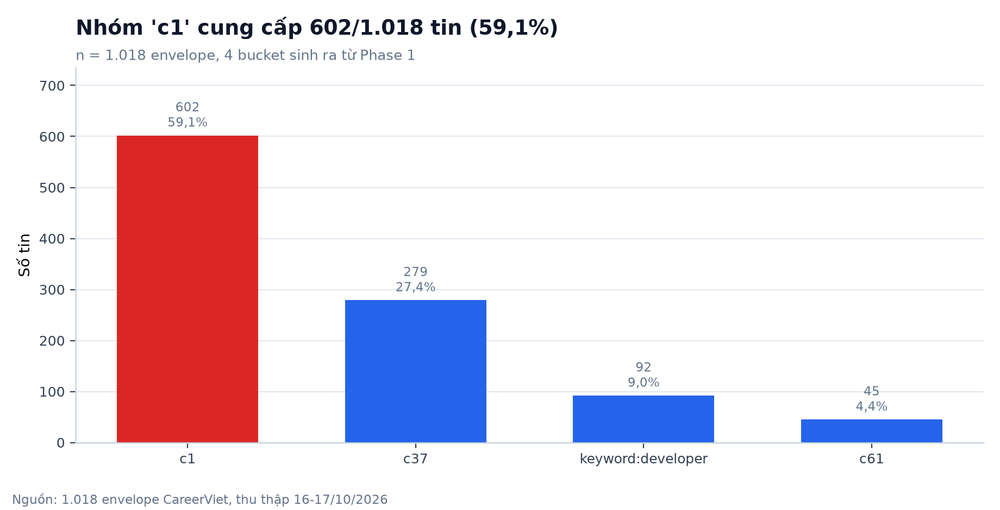

- **Quan sát:** c1 cho 602 tin (59,1%), c37 cho 279 tin (27,4%); đứng đầu là c1 + c37 đã chiếm 86,5% số tin.
- **Ý nghĩa:** Tỷ trọng này là hệ quả của việc chọn danh mục ở Phase 1 (độ rộng ngành của từng bucket), không phải độ nóng việc làm của thị trường.
- **Hạn chế:** Nhãn bucket lấy từ `metadata.source_category` - mỗi job_id chỉ mang một nhãn nên tổng cột đúng bằng số tin, nhưng chính crawler yêu cầu Data Integration KHÔNG dùng nó để lọc IT.

## 2. Tỷ lệ IT / ngoài IT (donut 3 nhóm)

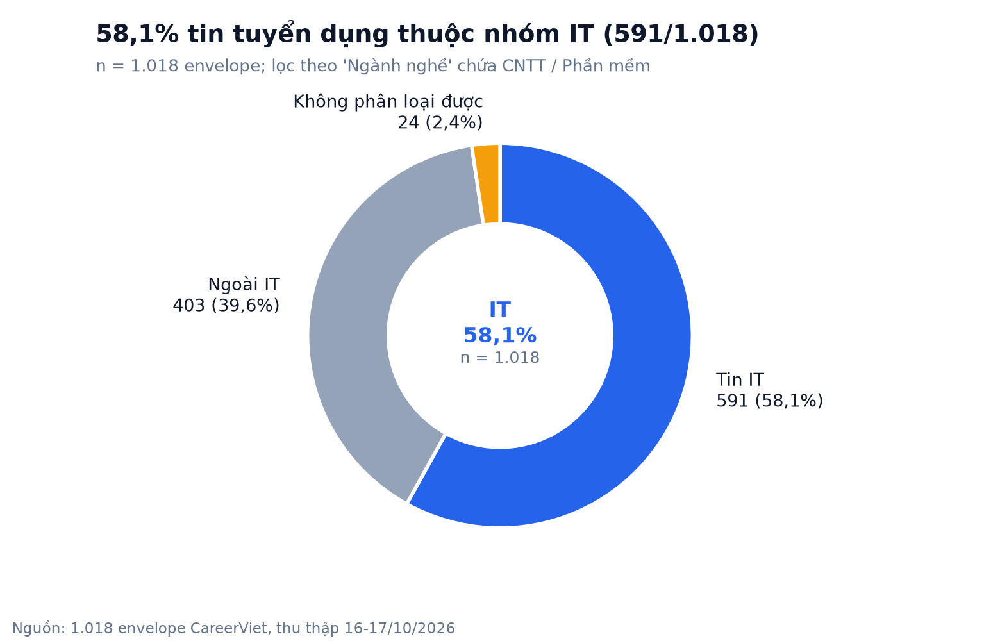

- **Quan sát:** IT 591 tin (58,1%), ngoài IT 403 tin (39,6%), và 24 tin (2,4%) rỗng 'Ngành nghề' được tách thành nhóm riêng thay vì gộp vào ngoài IT.
- **Ý nghĩa:** Sau bước lọc IT còn 427 tin không phải IT - đây là khối dữ liệu cần loại ở Phase 2, không phải 'phế liệu' bỏ quên.
- **Hạn chế:** Quy tắc khóa 'cntt/phan mem/phần mềm' có thể bỏ sót tin IT ghi ngành theo kỹ năng (Data, BA, QA...), đồng thời 24 tin tối giản không đủ căn cứ phân loại => 58,1% là cận dưới hợp lý, không phải tỷ lệ thị trường.

## 3. Tỷ lệ IT theo bucket

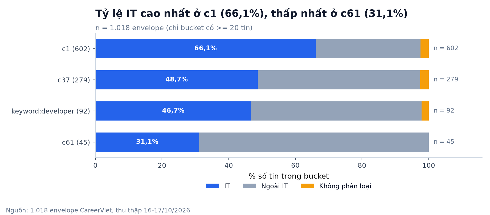

- **Quan sát:** c61: 31,1% IT (thấp nhất); c1: 66,1% IT (cao nhất); khoảng cách giữa 4 bucket lên tới 35 điểm phần trăm.
- **Ý nghĩa:** Bucket c1 là danh mục 'ruột' của mảng IT trên CareerViet, còn c61 chủ yếu đăng ngành ngoài IT.
- **Hạn chế:** Mỗi bucket là một quyết định chốt danh mục của Phase 1, không phải phép đo thị trường; so sánh tuyệt đối giữa các bucket dễ dẫn tới kết luận sai về nhu cầu tuyển dụng.

## 4. Độ phủ / tỷ lệ trống từng trường

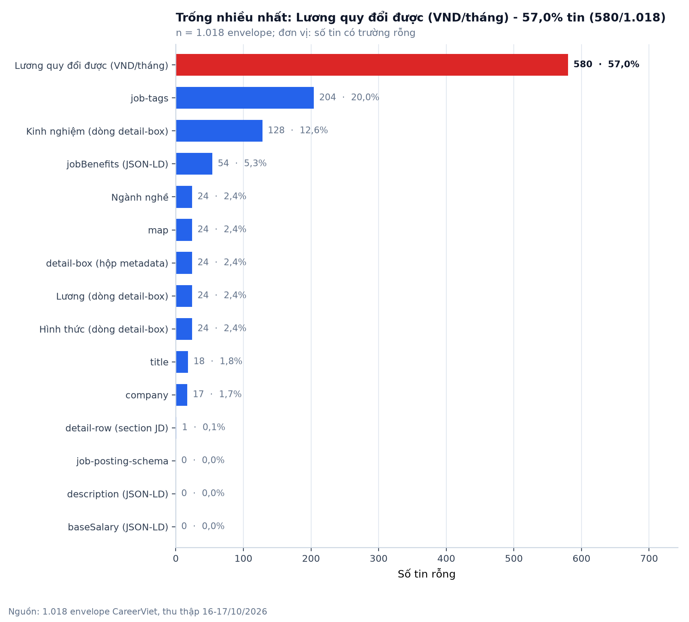

- **Quan sát:** Đứng đầu là Lương quy đổi được (VND/tháng) với 580 tin rỗng (57,0%), kế đến job-tags 204 tin (20,0%); trong khi đó `detail-box` chỉ rỗng ở 24 tin và `detail-row` rỗng ở 1 tin.
- **Ý nghĩa:** Các trường cần cho SD3/SD4 (tag, lương, map) có mức trống khác nhau nên không thể áp một ngưỡng hoàn thiện chung cho mọi mẫu.
- **Hạn chế:** Rỗng ở đây nghĩa là nguồn không cho giá trị trong SSR/JSON-LD; chưa đủ căn cứ kết luận lỗi trích xuất. Mức trống theo nhóm IT / ngoài IT được tách ở hình 10.

## 5. Phân bố lương (toàn mẫu)

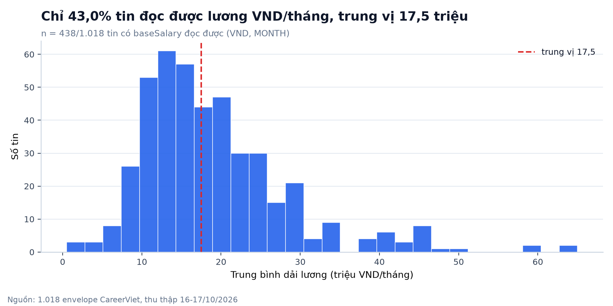

- **Quan sát:** 438/1.018 tin (43,0%) đọc được lương; trung vị 17,5, tứ phân vị 12,875-22,75, nhỏ nhất 0,5, lớn nhất 65 (triệu VND/tháng); 57,0% tin không đủ dữ liệu lương, trong đó 555 tin chỉ ghi 'Lương cạnh tranh'/'Thỏa thuận' ở dòng `detail-box`.
- **Ý nghĩa:** Mặt bằng lương công khai trong mẫu dồn ở dải 12,875-22,75 triệu/tháng; tỷ lệ công khai lương khác nhau giữa hai nhóm (IT 33,3% tin có lương, ngoài IT 58,3%).
- **Hạn chế:** 57,0% tin không đủ dữ liệu lương là thiên lệch chọn lọc lớn: cùng một công việc, nhà tuyển dụng công khai lương có thể khác nhóm 'Thỏa thuận', nên không suy ra được mặt bằng lương chung của thị trường.

## 6. Lương: IT vs ngoài IT (boxplot)

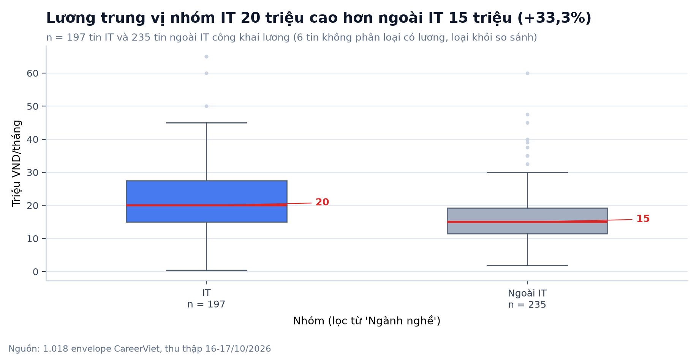

- **Quan sát:** IT n = 197: trung vị 20, IQR 15-27,5, tối đa 65. Ngoài IT n = 235: trung vị 15, IQR 11,5-19,5, tối đa 60. Chênh lệch trung vị +33,3%.
- **Ý nghĩa:** Trong phần tin công khai lương của CareerViet, nhóm IT không chỉ có mức trung vị cao hơn mà còn có biên độ (IQR) rộng hơn - nhất quán với tính chuyên môn hóa và phân tầng bậc của việc IT.
- **Hạn chế:** So sánh chỉ chạy trên 432 tin có lương (42,4% mẫu); tỷ lệ công khai lương của hai nhóm có thể khác nhau và chưa kiểm định thống kê (Mann-Whitney/t) => coi là giả thuyết hướng, không phải kết luận toàn thị trường.

## 7. Địa điểm làm việc

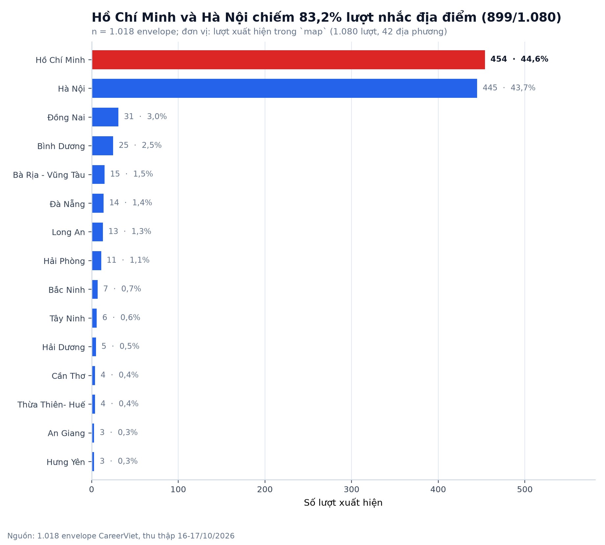

- **Quan sát:** Hồ Chí Minh 454 lượt (44,6%), Hà Nội 445 lượt (43,7%); tổng 1.080 lượt rải trên 42 địa phương, các tỉnh còn lại đều dưới 31 lượt.
- **Ý nghĩa:** Thị trường trong mẫu dồn ở hai địa bàn đầu bảng (83,2% lượt); 40 địa phương còn lại chỉ chiếm 16,8% lượt nên quá mỏng để phân tích vùng.
- **Hạn chế:** Một tin có thể ghi nhiều tỉnh (tách theo dấu phẩy) nên tổng lượt lớn hơn số tin; `map` rỗng ở 24 tin (2,4%).

## 8. Địa điểm × nhóm IT (heatmap)

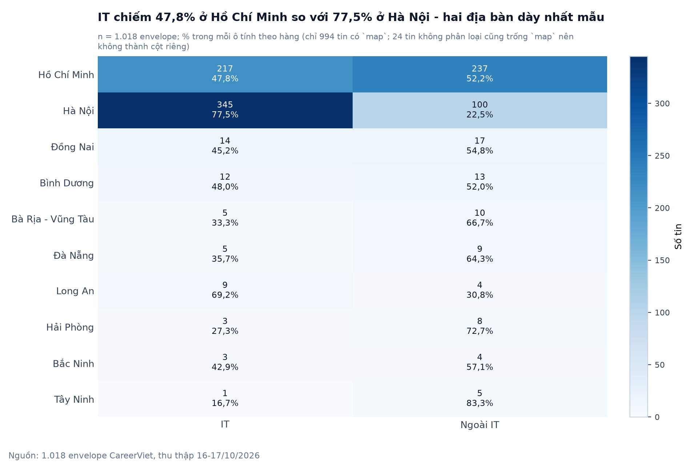

- **Quan sát:** Hồ Chí Minh: 217 IT / 237 ngoài IT (47,8% IT); Hà Nội: 345 IT / 100 ngoài IT (77,5% IT). Hai cực của bảng là Hà Nội (77,5% IT) và Tây Ninh (16,7% IT, chỉ 6 tin).
- **Ý nghĩa:** Cơ cấu IT / ngoài IT chênh 29,7 điểm phần trăm giữa hai địa bàn dày nhất (Hồ Chí Minh so với Hà Nội) - căn cứ để chốt địa bàn khi phân tích cụm kỹ năng theo vùng.
- **Hạn chế:** Hàng chỉ bao phủ tin có `map`; 24 tin rỗng `map` trùng chính xác với 24 tin không phân loại được nên không bị trừ hai lần; các hàng mỏng (như Tây Ninh chỉ 6 tin) có tỷ lệ rất dễ đổi, và không suy được cung - cầu nhân lực của từng tỉnh từ một ảnh chụp.

## 9. Tag kỹ năng toàn mẫu

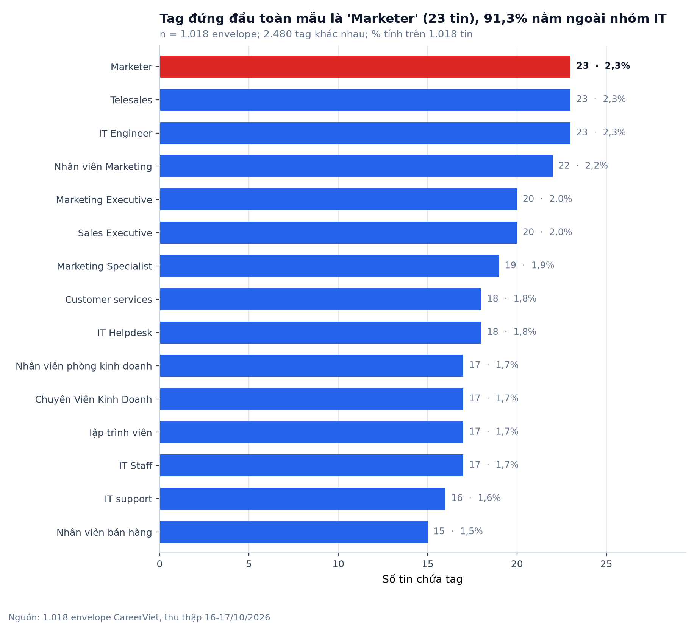

- **Quan sát:** 2.480 tag khác nhau; cao nhất 'Marketer' 23 tin (2,3%), trong đó 21 tin ngoài nhóm IT; top 15 trải trên 28,0% số tin; 204 tin (20,0%) không có tag nào.
- **Ý nghĩa:** Bảng tag toàn mẫu KHÔNG phải 'bộ kỹ năng IT': 41,9% tin thuộc ngành khác, nên 10/15 tag đứng đầu xuất hiện ở tin ngoài IT nhiều hơn ở tin IT.
- **Hạn chế:** Tag là chuỗi thô của nguồn, chưa chuẩn hóa (khác biệt hoa/thường, synonym), nên tần suất một kỹ năng bị phân tán; đây là lý do Phase 2 phải tách `Technical skills` và chuẩn hóa từ điển.

## 10. Tag trong 591 tin IT

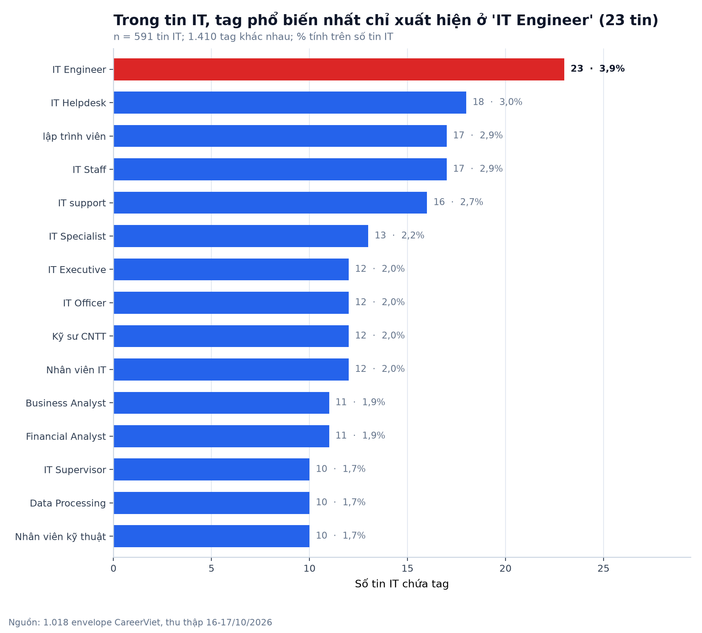

- **Quan sát:** 1.410 tag xuất hiện trong tin IT, cao nhất 'IT Engineer' 23 tin (3,9%); ba tag đứng đầu: IT Engineer 23, IT Helpdesk 18, lập trình viên 17. Tin IT không có tag: 138 (23,4%) so với ngoài IT 62 (15,4%).
- **Ý nghĩa:** Độ phủ tag của nhóm IT thấp hơn nhóm ngoài IT (23,4% so với 15,4% tin trống), nên lọc IT bằng `job-tags` sẽ mất nhiều tin hơn lọc bằng 'Ngành nghề'.
- **Hạn chế:** Tag đầu bảng chỉ phủ 23/591 tin IT (3,9%) nên đuôi rất ngắn; không đủ chứng cứ để nói IT 'thiếu kỹ năng' hay so sánh kỹ năng giữa ngành.

## 11. Nhà tuyển dụng

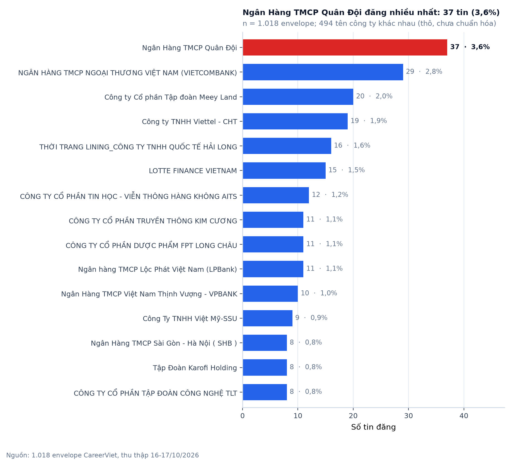

- **Quan sát:** 494 tên khác nhau phủ 1.001 tin có tên; cao nhất Ngân Hàng TMCP Quân Đội với 37 tin (3,6%); 22,0% số tin nằm trong top 15.
- **Ý nghĩa:** Nhà đăng nhiều nhất chỉ chiếm 3,6% số tin, nên mẫu này mô tả thị trường 'việc đăng rải' hơn là hệ sinh thái quây quanh vài doanh nghiệp lớn.
- **Hạn chế:** Tên công ty chưa chuẩn hóa (công ty mẹ/con, sai chính tả) => `distinct company` chỉ là cận trên; 17 tin (1,7%) không có tên.

## 12. Top 15 heading phúc lợi

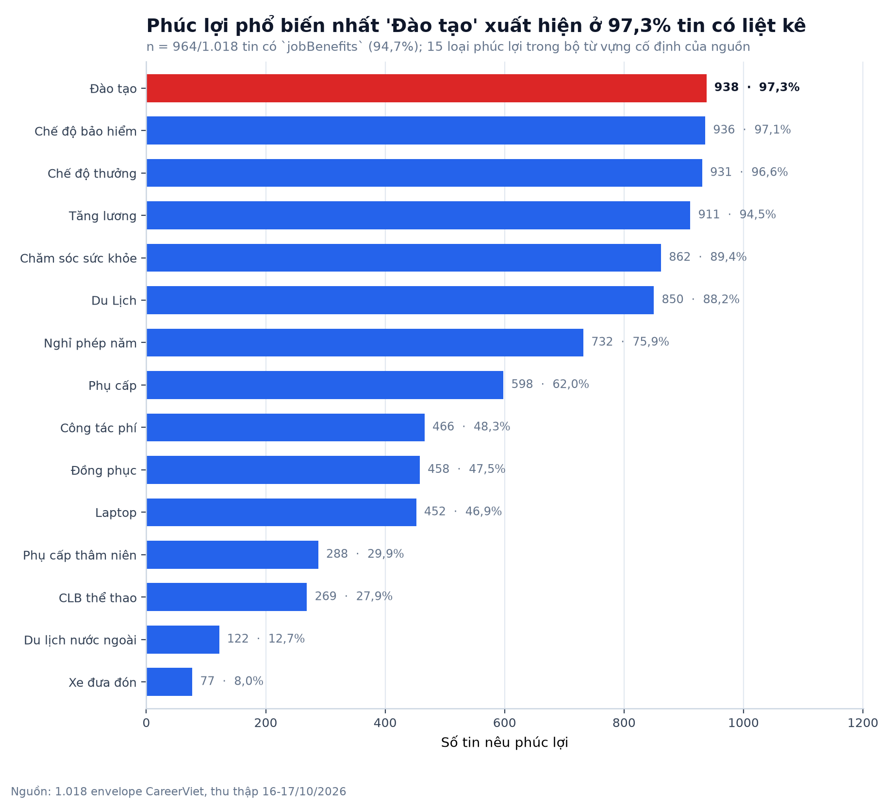

- **Quan sát:** `jobBenefits` (JSON-LD, chuỗi phân tách dấu phẩy) tách được 15 loại trên 964 tin (94,7%); dẫn đầu Đào tạo 938 tin (97,3%), Chế độ bảo hiểm 936 tin (97,1%), hiếm nhất 'Du lịch nước ngoài' 122 tin, 'Xe đưa đón' 77 tin.
- **Ý nghĩa:** Các phúc lợi đứng đầu (Đào tạo, Chế độ bảo hiểm, Chế độ thưởng, Tăng lương) là chuẩn chung của mọi ngành, nên chúng không phải điểm khác biệt giữa việc IT và việc ngoài IT trong mẫu này.
- **Hạn chế:** Số liệu chỉ ghi nhận 'có/không nêu tên phúc lợi', không có giá trị tiền tệ hay mức độ; so sánh phúc lợi theo nhóm IT cần tách cấu trúc ở Phase 2.

## 13. Ngày đăng tin

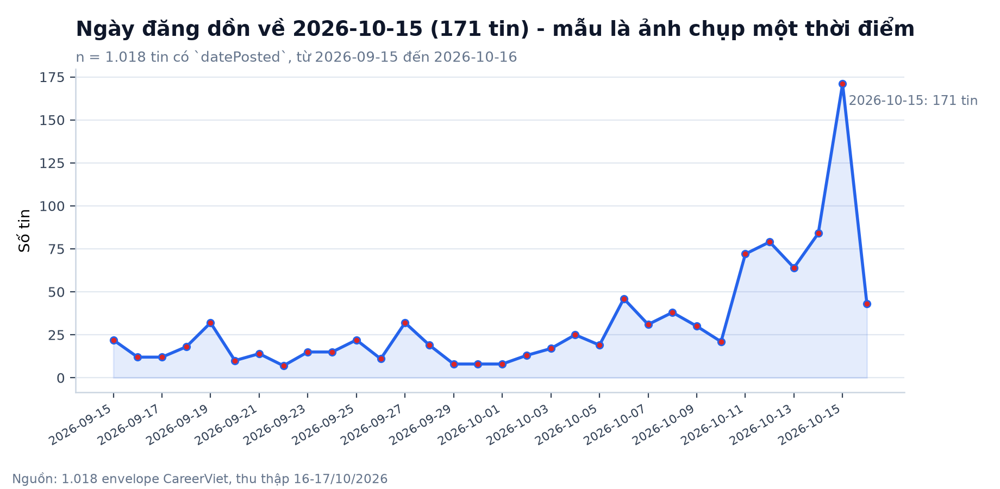

- **Quan sát:** 1.018/1.018 tin có `datePosted`, trải từ 2026-09-15 đến 2026-10-16 (32 ngày); cao nhất 2026-10-15 với 171 tin (16,8%).
- **Ý nghĩa:** Phân bố ngày đăng phản ánh nhịp đăng tin của nguồn trong 32 ngày, đủ để mô tả khoảng thời gian thu thập chứ không đo được lưu lượng việc IT.
- **Hạn chế:** Mỗi lần crawl là một ảnh khoanh khác nhau; 11 tin repost mang ngày đăng cũ nên phân bố này bị già hóa nhân tạo.

## 14. Hình thức làm việc

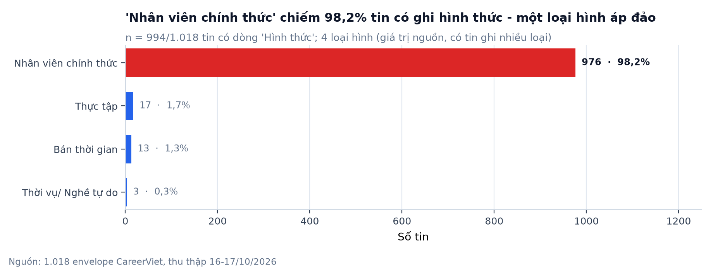

- **Quan sát:** Nhân viên chính thức 976 tin (98,2%); tổng 4 loại hình, hiếm nhất 'Bán thời gian' 13 tin, 'Thời vụ/ Nghề tự do' 3 tin; trường này trống ở 24 tin (2,4%).
- **Ý nghĩa:** Trường phân loại chỉ có 4 mức và 0 lượt ghi hình thức linh hoạt (remote/hybrid/tại nhà), nên muốn đo tỷ lệ làm từ xa phải bóc từ `detail-row` ở Phase 2.
- **Hạn chế:** Giá trị là chuỗi thô của nguồn (một tin ghi nhiều loại, tách dấu phẩy nên tổng có thể vượt số tin); không kết luận được tỷ lệ remote của thị trường từ trường phân loại này.

## 15. Độ dài nội dung mô tả công việc

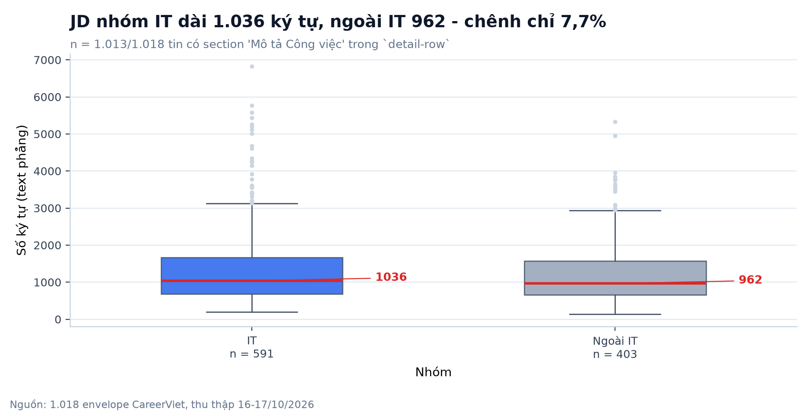

- **Quan sát:** Section 'Mô tả Công việc' (key của `detail-row`) xuất ở 1.013/1.018 tin (99,5%); các section khác: 'Yêu Cầu Công Việc': 1.017 tin, 'Phúc lợi': 1.017 tin; trung vị IT 1.036 ký tự so với ngoài IT 962 (+7,7%); 491 tin (48,2%) dưới 1.000 ký tự. `description` JSON-LD đầy đủ ở 1.018/1.018 tin, trung vị 2.127 ký tự text thuần (đã bóc thẻ HTML).
- **Ý nghĩa:** Độ dài JD hầu như không phân biệt việc IT với việc ngoài IT; muốn tách hai nhóm phải dùng nội dung (từ điển kỹ năng, Job Family), không dùng dung lượng văn bản.
- **Hạn chế:** `detail-box` CHỈ là hộp metadata (rỗng ở 24 tin), JD thật nằm trong `detail-row` và `job-posting-schema.description`; độ dài text phẳng chưa tính thẻ HTML nên không so sánh được với token của mô hình ngôn ngữ.

## 16. Ledger CDC (đối chiếu Phase 1)

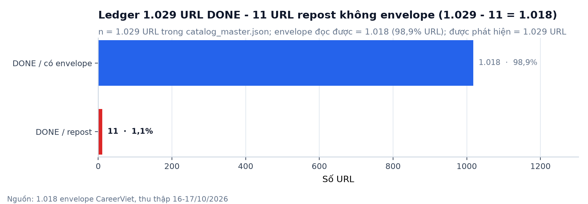

- **Quan sát:** catalog_master: 1.029 URL của careerviet, 1.029 DONE, 11 DONE + có `repost_of_url_hash`, 0 chưa DONE, 0 URL có `error_log`; 1.018 URL có `latest_version >= 1` = 1.018 envelope EDA.
- **Ý nghĩa:** Đẳng thức 1.029 URL - 11 repost = 1.018 envelope khớp chính xác với số tin đã đo; không có tin mất không rõ nguyên nhân và không có lỗi mạng tồn đọng.
- **Hạn chế:** Ledger là trạng thái tại thời điểm đọc; `manifests/*.jsonl` chỉ là ảnh chụp lúc phát hiện (vẫn ghi PENDING) nên không dùng nó để đo trạng thái crawl.

