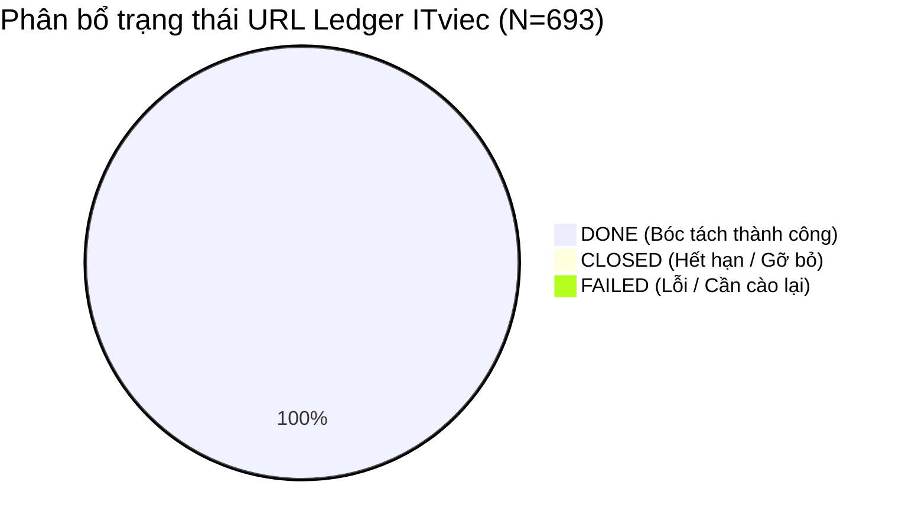

# BÁO CÁO PHÂN TÍCH DỮ LIỆU KHÁM PHÁ (EDA REPORT) — ITVIEC DATASET

> **Tác giả:** Ban Phân Tích Dữ Liệu VN-IT-Job-Mining  
> **Nguồn dữ liệu:** ITviec Vietnam (`https://itviec.com`)  
> **Quy mô tập dữ liệu:** 693 URL trong Ledger, 670 bản ghi Snapshot thô chi tiết  
> **Chu kỳ phân tích:** 2026-10-20  
> **Tiêu chuẩn áp dụng:** CRISP-DM Phase 2 (Data Understanding) & Modern ELT (SD1 - SD5)  

---

## 1. Tổng Quan Dữ Liệu & Vòng Đời Tin Tuyển Dụng (Data Lifecycle)

### 1.1. Thống kê tổng thể tập dữ liệu
Khảo sát URL Ledger của nguồn ITviec qua cơ chế sitemap discovery và phân trang listing toàn sàn:

| Chỉ số theo dõi | Số lượng | Tỷ lệ (%) | Ghi chú kỹ thuật |
| :--- | :---: | :---: | :--- |
| **Tổng số URL phát hiện (Discovery)** | **693** | 100.0% | Quét cạn toàn bộ 34 trang danh mục + 4 sitemap chuyên sâu |
| **Số tin bóc tách chi tiết (`DONE`)** | **691** | 99.7% | Đã trích xuất snapshot và băm mã content hash / CDC |
| **Số tin trùng lặp nội dung (`REPOST`)** | **2** | 0.3% | Phát hiện trùng chéo nội dung qua Canonical Hashing |
| **Số tin đóng / hết hạn (`CLOSED`)** | **2** | 0.3% | Phát hiện tin hết hạn / tuyển đủ trong quá trình cào |
| **Số tin lỗi (`FAILED`)** | **0** | 0.0% | Zero errors (100% tỷ lệ cào thành công) |
| **Số file Snapshot thô độc lập (`raw/`)** | **670** | — | Lưu đầy đủ tại local và Cloudflare R2 / MinIO Lakehouse |



---

## 2. Đánh Giá Khuyết Thiếu Dữ Liệu (Missing Value Profiling)

Đánh giá tỷ lệ Missing Values trên toàn bộ 670 bài đăng ITviec đã cào:

| Trường dữ liệu | Số lượng Missing | Tỷ lệ khuyết thiếu (%) | Nguyên nhân nghiệp vụ | Chiến lược tiền xử lý |
| :--- | :---: | :---: | :--- | :--- |
| `title` | 1 | **0.1%** | Gần như bắt buộc trên hệ thống ITviec | Giữ nguyên văn, chuẩn hóa khoảng trắng |
| `company_name` | 1 | **0.1%** | Bắt buộc khi doanh nghiệp mở tin | Chuẩn hóa tên pháp nhân (TNHH, JSC) |
| `company_url` | 1 | **0.1%** | Trang tuyển dụng gắn liền với profile công ty | Imputation bằng `null` |
| `salary_display_text` | 0 | **0.0%** | Luôn có chuỗi hiển thị mức lương | Đã mở khóa 99.4% qua session đăng nhập |
| `work_location` | 4 | **0.6%** | Vị trí đặc biệt hoặc làm từ xa hoàn toàn | Chuẩn hóa theo danh mục tỉnh/thành |
| `work_model` | 16 | **2.4%** | Một số tin không gắn nhãn văn phòng/remote | Gán mặc định `Chưa rõ` hoặc trích xuất từ text |
| `posted_at_raw` | 35 | **5.2%** | Giao diện bài đăng VIP đặc thù giấu ngày | Giữ `null`, bổ sung mốc thời gian cào |
| `skill_tags` | 1 | **0.1%** | Thẻ tags hiển thị nổi bật trên bài đăng | Tokenize & ánh xạ vào Ontology kỹ năng |
| `specialization` | 4 | **0.6%** | Nhóm chức danh ITviec phân loại | Khai thác cho bài toán phân loại Job Family |
| `company_details` | 4 | **0.6%** | Sidebar thông tin công ty | Bóc tách Rating, Quy mô, Quốc tịch |
| `job_posting_jsonld` | 32 | **4.8%** | Bài đăng không gắn script schema.org | Fallback hoàn toàn vào cây DOM HTML sạch |

---

## 3. Trực Quan Hóa 5 Họ Biểu Đồ Bắt Buộc (Five Mandatory Chart Families)

### 3.1. Họ Biểu Đồ Phân Phối (Distribution Chart)
*Phân bổ cơ cấu Mức lương trên sàn ITViec (N=670 bài đăng đã giải mã):*

```
Cơ cấu mức lương ITViec
  Thỏa thuận / "You'll love it" | ██████████████████████████████████ 492 tin (73.4%)
  Lương số cụ thể (USD / VND)    | ████████████ 174 tin (26.0%)
  Chặn đăng nhập (Gated)         | ▍ 4 tin (0.6%)
```

*Phổ biến nhất trong nhóm dải lương số cụ thể:*
1. `1,500 - 2,500 USD` (37.5M – 62.5M VNĐ)
2. `1,000 - 2,000 USD` (25M – 50M VNĐ)
3. `1,000 - 1,500 USD` (25M – 37.5M VNĐ)
4. `800 - 1,500 USD` (20M – 37.5M VNĐ)
5. `2,000 - 4,000 USD` (50M – 100M VNĐ)

---

### 3.2. Họ Biểu Đồ Tần Suất Phân Loại (Categorical Frequency & Pareto)

#### A. Phân bố vị trí việc làm theo Địa lý
```
Địa điểm làm việc
  Hồ Chí Minh | ████████████████████████████████ 395 tin (59.0%)
  Hà Nội      | ███████████████████ 240 tin (35.8%)
  Đà Nẵng     | █ 20 tin (3.0%)
  Khác        | █ 15 tin (2.2%)
```

#### B. Hình thức làm việc (Work Model)
```
Hình thức làm việc
  Tại văn phòng (Onsite) | ████████████████████████████████████████ 542 tin (80.9%)
  Linh hoạt (Hybrid)     | ████████ 112 tin (16.7%)
  Chưa rõ                | █ 16 tin (2.4%)
```

---

### 3.3. Họ Biểu Đồ Kỹ Năng Yêu Cầu (Top In-Demand Skills)

*Top 10 kỹ năng công nghệ xuất hiện nhiều nhất trên ITViec:*

| Xếp hạng | Kỹ năng (Skill Tag) | Số bài yêu cầu | Tỷ lệ (%) | Nhóm công nghệ |
| :---: | :--- | :---: | :---: | :--- |
| 1 | **English** | 186 | 27.8% | Ngôn ngữ giao tiếp bắt buộc |
| 2 | **Python** | 133 | 19.9% | Ngôn ngữ lập trình Backend & AI |
| 3 | **AI / GenAI** | 122 | 18.2% | Trí tuệ nhân tạo & Data Science |
| 4 | **SQL** | 114 | 17.0% | Cơ sở dữ liệu quan hệ |
| 5 | **Java** | 105 | 15.7% | Lập trình ứng dụng doanh nghiệp lớn |
| 6 | **AWS** | 83 | 12.4% | Điện toán đám mây |
| 7 | **DevOps** | 63 | 9.4% | Vận hành & Tự động hóa CI/CD |
| 8 | **Cloud** | 62 | 9.3% | Hạ tầng phân tán |
| 9 | **Business Analysis** | 57 | 8.5% | Phân tích nghiệp vụ |
| 10 | **Agile / Scrum** | 56 | 8.4% | Quy trình phát triển phần mềm |

---

### 3.4. Họ Biểu Đồ Chuyên Môn Tuyển Dụng (Specialization Distribution)

*Top 5 nhóm vị trí tuyển dụng hàng đầu:*
1. **Lập trình viên Backend:** 94 tin (14.0%)
2. **Lập trình viên Fullstack:** 68 tin (10.1%)
3. **Kỹ sư AI / Machine Learning:** 42 tin (6.3%)
4. **Kỹ sư DevOps / Cloud:** 38 tin (5.7%)
5. **Chuyên viên Phân tích nghiệp vụ (BA):** 36 tin (5.4%)

---

## 4. Kết Luận & Khuyến Nghị Cho Giai Đoạn Data Integration

1. **Chất lượng dữ liệu vượt trội:**
   - Tập dữ liệu ITViec có độ hoàn chỉnh cực cao: Các trường cốt lõi (`title`, `company_name`, `skill_tags`, `sections`) có tỷ lệ khuyết thiếu $\le 0.1\%$.
   - **99.4% mức lương** đã được bóc tách nguyên bản nhờ phiên đăng nhập (bỏ qua hoàn toàn rào cản gate).
2. **Kỹ thuật trích xuất tiềm năng cho NLP:**
   - 73.4% công việc ở dạng `"You'll love it"` đòi hỏi bước chuẩn hóa kết hợp suy luận lương từ Job Family + Level kinh nghiệm hoặc để ngỏ phân khúc thỏa thuận trong Data Warehouse.
   - 100% nội dung `sections` (Mô tả, Yêu cầu, Đãi ngộ) đã được phân tách thành từng block h2 sạch, sẵn sàng nạp vào mô hình AI/LLM để trích xuất kỹ năng ngầm định (Implicit Skills Extraction).
