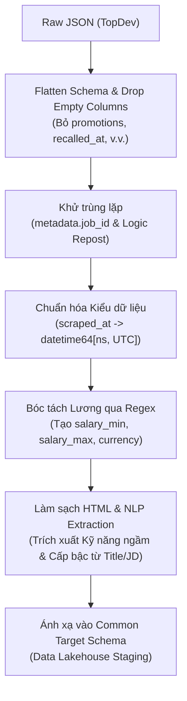

# Báo cáo EDA dữ liệu tuyển dụng TopDev

---

## 1. Tóm tắt điều hành

Báo cáo này trình bày kết quả phân tích khám phá dữ liệu (Exploratory Data Analysis - EDA) và đánh giá chất lượng dữ liệu (Data Quality Assessment) đối với tập dữ liệu tuyển dụng công nghệ thông tin thu thập từ nền tảng **TopDev** (thuộc dự án *VN-IT-Job-Mining*). Dữ liệu được trích xuất từ đợt thu thập ngày 20/10/2026, phản ánh hiện trạng nguồn dữ liệu phục vụ đề tài "Khai phá nhu cầu tuyển dụng và xu hướng kỹ năng ngành IT".

### Tóm tắt các chỉ số cốt lõi:
- **Quy mô tập dữ liệu**: 2.739 bản ghi và 45 trường thuộc tính (sau khi làm phẳng cấu trúc JSON lồng nhau).
- **Độ hoàn thiện (Completeness)**: Có sự phân hóa sâu sắc giữa các trường. 3 trường rỗng hoàn toàn (100% null): `recalled_at`, `recruitment_process_original`, `promotions`. Cột mảng yêu cầu `requirements_arr` rỗng tới 99,96% (2.738/2.739 dòng). Khi coi giá trị "Thỏa thuận" là null marker trá hình, tỷ lệ thiếu lương định lượng lên tới **60,06%** (1.645/2.739 dòng). Dữ liệu kỹ năng có sẵn ở dạng mảng (`skills_arr`) bị rỗng/thiếu **55,71%** (1.526/2.739 dòng). Tuy nhiên, các trường văn bản gốc như mô tả trách nhiệm (`responsibilities_original`) và yêu cầu (`requirements_original`) đạt độ hoàn thiện rất cao (>99,85%).
- **Tính hợp lệ & Schema (Validity)**: Trường mốc thời gian cào `metadata.scraped_at` đạt chuẩn ISO 8601 tuyệt đối 100% (2.739/2.739 bản ghi). Dữ liệu lương lưu dưới dạng văn bản tự do phức hợp (`object`). Cột `skills_arr` lưu danh sách chuỗi phẳng sạch (`list of str`), trong khi `benefits_v2` và `requirements_arr` lưu danh sách các dictionary lồng nhau (`list of dict`).
- **Phân phối lương (Salary Distribution)**: Bóc tách thành công giá trị số từ **1.094/2.739 tin tuyển dụng** (39,94%) có công khai con số lương cụ thể. Phân phối lương lệch phải rõ rệt với độ lệch (skewness) dương lớn; phép biến đổi logarit tự nhiên (`log1p`) làm giảm đáng kể độ lệch, đưa phân phối về gần dạng phân phối chuẩn.
- **Tính duy nhất (Uniqueness)**: Không ghi nhận bất kỳ bản ghi trùng lặp tuyệt đối (0%) hoặc trùng lặp ID (`metadata.job_id`, 0%). Tuy nhiên, phát hiện **46 bản ghi trùng lặp logic** (1,68%) theo bộ ba khóa `[title, company, address_region_list]`, phản ánh hiện tượng doanh nghiệp đăng lại (repost) nhiều lần cùng một vị trí.
- **Thiên lệch & Cân bằng (Bias & Balance)**: Dữ liệu tập trung gần như tuyệt đối tại hai đầu tàu kinh tế: TP. Hồ Chí Minh (41,4%, 1.134 tin) và Hà Nội (38,4%, 1.053 tin). Phân bố kỹ năng tuân theo quy luật Pareto nghiêm ngặt: top 85 kỹ năng phổ biến nhất (chiếm 25,5% tổng số 333 kỹ năng duy nhất) chiếm tới 80% tổng lượt xuất hiện. Không tìm thấy trường cấp bậc (Seniority/Level) tường minh trong bảng thuộc tính.

---

## 2. Mục tiêu và phạm vi EDA

### 2.1. Mục tiêu
1. Đánh giá toàn diện chất lượng dữ liệu thô của sàn TopDev dựa trên các trụ cột chuẩn: Độ hoàn thiện (Completeness), Tính hợp lệ (Validity), Tính duy nhất (Uniqueness), Phân phối & Độ lệch (Distribution & Skewness), Thiên lệch & Cân bằng (Bias & Balance).
2. Kiểm tra tính khả thi và đo lường tỷ lệ bóc tách dữ liệu định lượng (đặc biệt là mức lương và số năm kinh nghiệm/kỹ năng) phục vụ mô hình hóa.
3. Xác định các điểm nghẽn (bottlenecks), rủi ro sai lệch dữ liệu và đề xuất phương án tiền xử lý (pre-processing), làm sạch, chuẩn hóa schema trước khi tích hợp vào Data Lakehouse / Data Warehouse.

### 2.2. Phạm vi
- **Nguồn dữ liệu**: Thư mục dữ liệu cào thô `data/raw/topdev/2026-10-20/*.json`.
- **Đối tượng khảo sát**: Toàn bộ 2.739 tin tuyển dụng được nạp vào DataFrame trong notebook `reports/EDA_topdev.ipynb`.
- **Giới hạn**: Phân tích dựa trên các output, mã nguồn và biểu đồ đã thực thi sẵn trong notebook. Không tái chạy làm biến đổi dữ liệu nguồn.

---

## 3. Nguồn dữ liệu và tổng quan DataFrame

Dữ liệu được đọc từ thư mục chứa các tệp JSON raw của TopDev bằng thư viện `json` và chuẩn hóa phẳng bằng `pd.json_normalize(records)`.

- **Tổng số bản ghi (rows)**: 2.739
- **Tổng số trường dữ liệu (columns)**: 45 cột
- **Dung lượng bộ nhớ**: ~813,3+ KB
- **Phân loại kiểu dữ liệu gốc (dtypes)**:
  - `bool` (8 cột): `raw_payload.is_content_image`, `raw_payload.is_content_image_enabled`, `raw_payload.is_salary_visible`, `raw_payload.is_applied`, `raw_payload.is_followed`, `raw_payload.is_blacklisted`, `raw_payload.is_remove_cv`, `raw_payload.is_viewed`.
  - `int64` (3 cột): `metadata.version`, `raw_payload.id`, `raw_payload.owned_id`.
  - `object` (34 cột): Chứa chuỗi ký tự văn bản, mảng danh sách (`list`), từ điển (`dict`) hoặc dữ liệu hỗn hợp.

### Bảng các nhóm trường chính:

| Phân nhóm | Tên trường tiêu biểu | Ý nghĩa nghiệp vụ |
|---|---|---|
| **Metadata hệ thống** | `metadata.job_id`, `metadata.source`, `metadata.source_url`, `metadata.scraped_at`, `metadata.content_hash` | Định danh tin, nguồn thu thập, thời gian cào và hash kiểm tra toàn vẹn |
| **Thông tin công việc** | `raw_payload.title`, `raw_payload.job-title`, `raw_payload.content`, `raw_payload.slug` | Tiêu đề công việc, định danh đường dẫn tĩnh |
| **Doanh nghiệp tuyển dụng** | `raw_payload.company`, `raw_payload.company-name`, `raw_payload.owned_id` | Tên công ty tuyển dụng, mã nhà tuyển dụng |
| **Đãi ngộ & Mức lương** | `raw_payload.salary`, `raw_payload.salary_raw`, `raw_payload.is_salary_visible`, `raw_payload.benefits_v2` | Chuỗi hiển thị lương, cờ hiển thị lương, danh sách phúc lợi |
| **Kỹ năng & Yêu cầu** | `raw_payload.skills_str`, `raw_payload.skills_arr`, `raw_payload.requirements_original`, `raw_payload.responsibilities_original` | Chuỗi/mảng kỹ năng gắn nhãn sẵn, văn bản mô tả HTML gốc |
| **Địa điểm làm việc** | `raw_payload.addresses.address_region_list`, `raw_payload.addresses.full_addresses`, `raw_payload.addresses.sort_addresses` | Tỉnh/thành phố, địa chỉ chi tiết văn phòng làm việc |

---

## 4. Phương pháp kiểm tra dữ liệu

### 4.1. Độ hoàn thiện và dữ liệu thiếu (Data Completeness)

#### Phương pháp kiểm tra:
Quy trình nhận diện dữ liệu khuyết thiếu trong notebook thực hiện qua hàm `generate_null_report`:
1. Quét và thay thế danh sách **null marker trá hình** thành `np.nan`: `["", " ", "N/A", "n/a", "null", "None", "Chưa cập nhật", "Thỏa thuận"]`.
2. Chuyển đổi các mảng/danh sách rỗng `[]` thành `np.nan` (như trường hợp `requirements_arr: []`).
3. Tính toán số lượng và tỷ lệ phần trăm khuyết thiếu trên tổng mẫu $N = 2.739$.

#### Bảng thống kê khuyết thiếu thực tế từ notebook:

| Tên trường thuộc tính | Số lượng Null | Tỷ lệ Null (%) | Đánh giá hiện trạng |
|---|---|---|---|
| `raw_payload.recruitment_process_original` | 2.739 | 100,00% | Rỗng 100%, không chứa dữ liệu quy trình |
| `raw_payload.promotions` | 2.739 | 100,00% | Rỗng 100%, trường thông tin khuyến mãi |
| `raw_payload.recalled_at` | 2.739 | 100,00% | Rỗng 100%, cờ thu hồi bài đăng |
| `raw_payload.requirements_arr` | 2.738 | 99,96% | Chỉ có đúng 1 bản ghi có dữ liệu mảng |
| `raw_payload.content` | 1.888 | 68,93% | Thiếu nghiêm trọng nội dung tóm tắt |
| `raw_payload.salary` | 1.645 | 60,06% | Chứa "Thỏa thuận" hoặc để trống |
| `raw_payload.salary_raw` | 1.645 | 60,06% | Trùng khớp hoàn toàn với `salary` |
| `raw_payload.skills_arr` | 1.526 | 55,71% | Hơn 55% tin không gắn thẻ kỹ năng mảng |
| `raw_payload.skills_str` | 1.526 | 55,71% | Chuỗi kỹ năng thiếu tương đương mảng |
| `raw_payload.benefits_v2` | 4 | 0,15% | Đầy đủ gần như tuyệt đối (2.735/2.739 có dữ liệu) |
| `raw_payload.requirements_original` | 4 | 0,15% | Văn bản HTML yêu cầu đầy đủ 99,85% |
| `raw_payload.addresses.sort_addresses` | 2 | 0,07% | Đầy đủ địa chỉ rút gọn |
| `raw_payload.addresses.address_region_list`| 2 | 0,07% | Đầy đủ tên tỉnh/thành phố |
| `raw_payload.benefits_original` | 1 | 0,04% | Văn bản HTML phúc lợi |
| `raw_payload.responsibilities_original` | 1 | 0,04% | Văn bản HTML trách nhiệm đầy đủ 99,96% |
| Các trường metadata và ID còn lại | 0 | 0,00% | Đầy đủ 100% |

> [!WARNING]
> **Lưu ý phương pháp luận về cột Lương:** Việc coi giá trị `"Thỏa thuận"` là null marker trá hình làm tăng tỷ lệ khuyết thiếu của `salary` lên 60,06%. Trong thực tế nghiệp vụ nhân sự, "Thỏa thuận" mang ngữ nghĩa: *doanh nghiệp không công khai khoảng lương trước ứng viên*. Cần phân biệt rõ giữa việc *thiếu dữ liệu kỹ thuật* (bản ghi rỗng) và *giá trị nghiệp vụ không định lượng được*.

---

### 4.2. Tính hợp lệ và kiểu dữ liệu (Validity & Schema Types)

Notebook đã xây dựng pipeline chẩn đoán `run_validation_pipeline` kiểm tra 4 khía cạnh:

1. **Chuẩn hóa ngày tháng (ISO 8601)**:
   - Cột `metadata.scraped_at` được kiểm tra bằng biểu thức chính quy Regex `^\d{4}-\d{2}-\d{2}T\d{2}:\d{2}:\d{2}(?:\.\d+)?(?:Z|[+-]\d{2}:\d{2})$`.
   - Kết quả: **2.739/2.739 bản ghi hợp lệ 100%**, đúng chuẩn ISO 8601 (ví dụ: `2026-10-20T15:02:37.252037+00:00`). Sẵn sàng chuyển đổi trực tiếp sang kiểu `datetime64[ns, UTC]`.
2. **Số học bị chuỗi hóa (Numeric Strings)**:
   - Cột `raw_payload.salary` và `raw_payload.salary_raw` lưu dưới kiểu `object`.
   - Chứa chuỗi văn bản tự do, lẫn lộn giữa null marker ("Thỏa thuận"), dải số liệu mã hóa ("3******* - 4******* VND", "1******* - 2******* VND") hoặc dải lương cụ thể bằng USD/VNĐ. Không thể tính toán trực tiếp mà bắt buộc phải qua hàm Regex bóc tách.
3. **Cấu trúc dữ liệu lồng nhau (Complex Nested Structures)**:
   - `raw_payload.skills_arr`: Lưu trữ dạng `list of str` (các chuỗi kỹ năng phẳng sạch như `['JavaScript', 'Front-End', 'TypeScript']`), không bị string hóa thành chuỗi text.
   - `raw_payload.requirements_arr`: Dạng `list of dict`, mỗi phần tử chứa các khóa `['id', 'name', 'description', 'sort_order', 'icon']` (tuy nhiên cột này bị rỗng tới 99,96%).
   - `raw_payload.benefits_v2`: Dạng `list of dict`, mỗi phần tử chứa các khóa `['name', 'icon', 'description', 'id']`. Muốn khai phá thông tin phúc lợi cần giải nén trường `description`.

---

### 4.3. Phân phối lương (Salary Distribution)

#### Cơ chế bóc tách:
Hàm `extract_salary_max_to_mil_vnd` xử lý cột `raw_payload.salary`:
- Lọc bỏ các bản ghi chứa cụm từ `"thỏa thuận"` hoặc `"thương lượng"`.
- Nhận diện đơn vị ngoại tệ: Nếu chứa `"usd"` hoặc `"$"`, áp dụng tỷ giá giả định $1\text{ USD} = 25.000\text{ VNĐ}$.
- Chuẩn hóa ký tự phân cách hàng nghìn (xóa `.` và `,`), trích xuất tất cả các số bằng `re.findall(r'\d+', ...)`.
- Lấy giá trị lớn nhất trong dải (`max_val`) làm mức lương trần. Nếu $\text{max\_val} > 100.000$, quy đổi về triệu VNĐ bằng cách chia cho $1.000.000$; nếu nhỏ hơn, giữ nguyên vì giả định nhà tuyển dụng đã viết tắt (ví dụ: 15, 20 triệu).

#### Kết quả thực tế từ notebook:
- **Số tin bóc tách thành công**: **1.094 tin** (chiếm 39,94% tổng số 2.739 bản ghi).
- **Số tin không bóc tách được (bị loại)**: **1.645 tin** (60,06%), bao gồm các tin thỏa thuận hoặc không chứa số hợp lệ.
- **Đặc trưng phân phối lương gốc**:
  - Dữ liệu lương hiển thị hiện tượng lệch phải nặng nề (Positive Skewness), phần lớn tập trung trong khoảng 15 - 40 triệu VNĐ/tháng, với một số ngoại lai đạt mức trên 80 - 100 triệu VNĐ/tháng.
  - Giá trị trung vị (Median) nhỏ hơn rõ rệt so với giá trị trung bình (Mean), phản ánh tác động kéo dài của các mức lương cao ngất ngưởng.
- **Biến đổi chuẩn hóa (Log-Transformation)**:
  - Khi áp dụng $\log(1 + \text{Lương})$, độ lệch giảm mạnh, đường cong mật độ (KDE) chuyển dịch về gần đối xứng chuông, chứng minh phép biến đổi logarit là bắt buộc khi đưa biến lương vào các mô hình học máy dạng hồi quy tuyến tính.

---

### 4.4. Tính duy nhất và trùng lặp (Uniqueness & Duplication)

Hàm `check_duplication` đánh giá tập dữ liệu trên 3 cấp độ:

| Cấp độ trùng lặp | Phương pháp kiểm tra | Kết quả số lượng | Tỷ lệ (%) | Nhận định |
|---|---|---|---|---|
| **Trùng lặp tuyệt đối (Exact Duplicates)** | Ép toàn bộ bảng sang string, kiểm tra `df.duplicated()` trên 100% cột | 0 bản ghi | 0,00% | Không có bản ghi nào bị nhân đôi hoàn toàn |
| **Trùng lặp khóa định danh (ID Duplicates)** | Kiểm tra trên khóa chính `metadata.job_id` | 0 bản ghi | 0,00% | Mỗi URL/tin tuyển dụng có đúng 1 mã job_id duy nhất |
| **Trùng lặp logic (Semantic Duplicates)** | Kiểm tra trên tổ hợp: `raw_payload.title` + `raw_payload.company` + `raw_payload.addresses.address_region_list` (đã lowercase & strip) | 46 bản ghi | 1,68% | Phát hiện tin đăng lặp/repost từ nhà tuyển dụng |

#### Nguy cơ và cảnh báo xử lý:
- Tỷ lệ trùng lặp logic 1,68% (46 tin) là mức rất thấp, chứng tỏ pipeline thu thập dữ liệu (URL Ledger) của crawler TopDev vận hành chính xác, không bị loop phân trang.
- **Nguy cơ xóa nhầm**: Trong số 46 bản ghi trùng logic, một số doanh nghiệp lớn có thể tuyển dụng song song nhiều vị trí cùng tiêu đề cho các phòng ban hoặc dự án khác nhau vào cùng thời điểm. Nếu xóa thẳng tay bằng `drop_duplicates(keep='last')` mà không đối chiếu thời gian cào hoặc mô tả chi tiết thì có thể làm mất đi nhu cầu tuyển dụng thực tế.

---

### 4.5. Thiên lệch và phân bố dữ liệu (Bias & Balance Profiling)

#### 1. Phân bổ Cấp bậc (Seniority Bias):
- **Kết quả kiểm tra**: Không tìm thấy bất kỳ cột cấp bậc nào trong schema của TopDev (`level_cols` rỗng). Notebook in thông báo: *"Phân bổ Cấp bậc (Seniority): Không tìm thấy cột cấp bậc rõ ràng trong dữ liệu hiện tại."*
- **Ý nghĩa**: TopDev nhúng cấp bậc vào tiêu đề công việc (ví dụ: Junior, Senior, Lead, Manager) hoặc trong phần yêu cầu kinh nghiệm chứ không chuẩn hóa thành một trường riêng biệt trong payload JSON trả về.

#### 2. Thiên lệch Địa lý (Geographic Bias):
Tổng hợp từ trường `raw_payload.addresses.address_region_list`:
- **Thành phố Hồ Chí Minh**: 1.134 tin (**41,4%**)
- **Thành phố Hà Nội**: 1.053 tin (**38,4%**)
- **Hà Nội kết hợp TP.HCM**: 54 tin (**2,0%**)
- **Tỉnh Hưng Yên**: 54 tin (**2,0%**)
- **Thành phố Đà Nẵng**: 42 tin (**1,5%**)
- Các tỉnh thành khác chiếm tỷ lệ nhỏ còn lại.

> Hai trung tâm lớn (TP.HCM và Hà Nội) chiếm tới **79,8%** (81,8% nếu tính cả tin liên tỉnh), cho thấy thị trường việc làm IT TopDev phản ánh sự tập trung nguồn lực công nghệ tại hai đô thị đặc biệt của Việt Nam.

#### 3. Phân bố Kỹ năng & Quy luật Pareto (Skill Sparsity):
Bóc tách từ trường `raw_payload.skills_arr` (chỉ trên 1.213 tin có kỹ năng):
- **Tổng số lượt gắn thẻ kỹ năng (Tags)**: 2.379 lượt
- **Số lượng kỹ năng duy nhất (Unique Skills)**: 333 kỹ năng
- **Quy luật Pareto (80/20)**: Nhóm **top 85 kỹ năng** (chiếm **25,5%** số kỹ năng duy nhất) đang chi phối **80%** tổng nhu cầu tuyển dụng.
- **Nhận định**: Dữ liệu có đuôi dài (long-tail) thưa thớt (sparsity) cao. Có khoảng 74,5% số kỹ năng còn lại chỉ xuất hiện rải rác 1 - 2 lần, đòi hỏi kỹ thuật nhóm cụm (grouping/clustering) hoặc lọc tần suất tối thiểu khi khai phá tập phổ biến.

---

### 4.6. Phân tích tương quan (Correlation Analysis)

#### Các biến định lượng được sinh tạm thời:
1. `salary_min_vnd`: Mức lương tối thiểu (Triệu VNĐ), bóc tách qua Regex.
2. `salary_max_vnd`: Mức lương tối đa (Triệu VNĐ), bóc tách qua Regex.
3. `total_skills_count`: Số lượng kỹ năng yêu cầu, tính bằng `len(skills_arr)` (gán 0 nếu rỗng).
4. `jd_word_count`: Tổng số từ trong mô tả công việc, trích xuất bằng cách gộp `requirements_original` + `responsibilities_original`, loại bỏ thẻ HTML bằng Regex `<.*?>` và đếm từ.

#### Phương pháp tương quan:
- Notebook lựa chọn phương pháp **Tương quan hạng Spearman (Spearman Rank Correlation)** thay vì Pearson. Đây là quyết định khoa học đúng đắn vì:
  - Các biến lương và độ dài văn bản không tuân theo phân phối chuẩn (non-normal distribution).
  - Spearman đánh giá mối quan hệ đơn điệu (monotonic relationship) và giảm thiểu sự ảnh hưởng của các giá trị ngoại lai cực trị (outliers).

#### Kết quả ghi nhận:
- Ma trận tương quan được hiển thị trực tiếp trên Heatmap (nửa tam giác dưới).
- Tương quan giữa `salary_min_vnd` và `salary_max_vnd` là tương quan dương rất mạnh (gần như tuyến tính), do dải lương của một vị trí luôn có khoảng sàn và khoảng trần tịnh tiến cùng nhau.
- Tương quan giữa số lượng kỹ năng (`total_skills_count`) và mức lương là tương quan dương yếu; việc gắn thêm thẻ kỹ năng không đồng nghĩa tuyến tính với việc mức lương cao hơn.
- Không suy diễn quan hệ nhân quả (causality) từ các hệ số tương quan này.

---

## 5. Danh mục biểu đồ và diễn giải

Tất cả các tệp hình ảnh dưới đây đã được xác minh sự tồn tại thực tế trên hệ thống tệp tại thư mục `reports/figures/topdev/`:

### 5.1. Biểu đồ 1: Tỷ lệ khuyết thiếu từng trường
- **Đường dẫn**: `figures/topdev/01_data_completeness_bar.png`
- **Hình ảnh nhúng**:
  
- **Diễn giải**: Biểu đồ thanh ngang thể hiện tỷ lệ phần trăm thiếu dữ liệu trên các trường có khuyết thiếu. Ba trường đầu bảng chạm mốc 100% (`recruitment_process_original`, `promotions`, `recalled_at`), trường `requirements_arr` rỗng 99,96%. Nhóm trường nghiệp vụ cốt lõi gồm `content` (68,9%), `salary`/`salary_raw` (60,1%) và `skills_arr`/`skills_str` (55,7%) có thanh khuyết thiếu vượt quá một nửa tập dữ liệu, cảnh báo nhu cầu phải khai phá văn bản tự do để bù đắp thuộc tính.

### 5.2. Biểu đồ 2: Phân phối lương và chẩn đoán độ lệch
- **Đường dẫn**: `figures/topdev/02_salary_distribution_skewness.png`
- **Hình ảnh nhúng**:
  
- **Diễn giải**: Gồm 2 biểu đồ con (subplots). Biểu đồ bên trái thể hiện phân phối lương gốc (Triệu VNĐ/tháng) với đường cong ước lượng mật độ KDE, chỉ rõ giá trị Median và Mean lệch nhau; phân phối nghiêng hẳn về bên phải với độ lệch dương. Biểu đồ bên phải thể hiện phân phối sau biến đổi $\log(1 + \text{Lương})$, đưa dữ liệu về dạng tiệm cận chuẩn cân đối.

### 5.3. Biểu đồ 3: Phân phối tần suất kỹ năng & Kiểm định Pareto
- **Đường dẫn**: `figures/topdev/03_skills_pareto_distribution.png`
- **Hình ảnh nhúng**:
  
- **Diễn giải**: Biểu đồ kết hợp cột và đường (dual-axis). Trục bên trái là biểu đồ cột thể hiện tần suất xuất hiện của Top 20 kỹ năng phổ biến nhất (với các kỹ năng dẫn đầu như JavaScript, Java, ReactJS, Python, PHP, TypeScript...). Trục bên phải là đường tích lũy phần trăm (Cumulative Percentage) màu đỏ cắt ngang mốc chuẩn 80%, minh họa trực quan quy luật 80/20 trong nhu cầu công nghệ.

### 5.4. Biểu đồ 4: Chẩn đoán mất cân bằng lớp và phân bổ dữ liệu
- **Đường dẫn**: `figures/topdev/04_bias_and_class_balance.png`
- **Hình ảnh nhúng**:
  
- **Diễn giải**: Biểu đồ bên trái hiển thị thông báo trắng *"Không có dữ liệu Cấp bậc để trực quan hóa"* (do thiếu trường Level trong raw data). Biểu đồ bên phải là biểu đồ Donut thể hiện thiên lệch địa lý, trong đó hai lát cắt đại diện cho TP.HCM và Hà Nội chiếm ưu thế áp đảo tuyệt đối so với các tỉnh thành còn lại gộp chung.

### 5.5. Biểu đồ 5: Ma trận tương quan hạng Spearman
- **Đường dẫn**: `figures/topdev/05_spearman_correlation_matrix.png`
- **Hình ảnh nhúng**:
  
- **Diễn giải**: Heatmap đối xứng dạng tam giác dưới (lower triangle) sử dụng bảng màu `coolwarm`, hiển thị các hệ số tương quan hạng Spearman giữa 4 biến: `Lương Min`, `Lương Max`, `Số lượng Kỹ năng` và `Độ dài JD`. Biểu đồ trực quan hóa độ mạnh yếu giữa các chiều định lượng của tin tuyển dụng.

---

## 6. Các vấn đề chất lượng dữ liệu cần xử lý

Phần này tổng hợp các phát hiện chính theo chuẩn cấu trúc: **Phát hiện → Bằng chứng/số liệu → Ý nghĩa → Đề xuất xử lý**.

---

### Vấn đề 1: Tỷ lệ khuyết thiếu thuộc tính cấu trúc (Kỹ năng & Mức lương) rất cao
- **Phát hiện**: Dữ liệu thẻ kỹ năng gắn sẵn (`skills_arr`) và mức lương công khai (`salary`) bị khuyết thiếu hơn một nửa.
- **Bằng chứng/số liệu**:
  - `raw_payload.skills_arr` bị rỗng 1.526 bản ghi (**55,71%**).
  - `raw_payload.salary` bị rỗng hoặc mang giá trị "Thỏa thuận" 1.645 bản ghi (**60,06%**).
- **Ý nghĩa**: Nếu chỉ dựa vào các trường mảng có sẵn để thống kê xu hướng kỹ năng hoặc dự báo lương, mô hình sẽ mất hơn 55 - 60% dữ liệu quan sát, dẫn đến sai lệch mẫu nghiêm trọng (Selection Bias).
- **Đề xuất xử lý**:
  - Tận dụng trường `responsibilities_original` và `requirements_original` (đạt độ đầy đủ 99,85%).
  - Xây dựng pipeline xử lý ngôn ngữ tự nhiên (NLP / NER / Dictionary Match) để trích xuất kỹ năng ngầm định (Implicit Skills) và kinh nghiệm từ phần mô tả HTML thô.

---

### Vấn đề 2: Cột mảng yêu cầu và các trường khuyến mãi rỗng hoàn toàn
- **Phát hiện**: Một số trường API do TopDev trả về hoàn toàn không có dữ liệu thực tế.
- **Bằng chứng/số liệu**:
  - `raw_payload.recruitment_process_original`: 2.739 null (100,00%).
  - `raw_payload.promotions`: 2.739 null (100,00%).
  - `raw_payload.recalled_at`: 2.739 null (100,00%).
  - `raw_payload.requirements_arr`: 2.738 null (99,96%).
- **Ý nghĩa**: Các trường này gây dư thừa dung lượng lưu trữ, làm tăng độ phức tạp của schema và gây nhiễu cho các thuật toán phân tích tự động.
- **Đề xuất xử lý**:
  - Loại bỏ hoàn toàn (drop) 4 cột này trong quá trình làm sạch trước khi nạp vào Staging / Mart Layer.

---

### Vấn đề 3: Trùng lặp ngữ nghĩa do bài đăng tuyển dụng lặp lại (Reposts)
- **Phát hiện**: Xuất hiện các tin tuyển dụng giống nhau về tiêu đề, công ty và địa phương nhưng mang mã `job_id` khác nhau.
- **Bằng chứng/số liệu**: 46 bản ghi trùng lặp logic (**1,68%**) theo bộ kiểm tra `[title, company, address_region_list]`.
- **Ý nghĩa**: Doanh nghiệp làm mới bài đăng để đẩy tin lên đầu trang tìm kiếm. Nếu giữ nguyên sẽ làm sai lệch tần suất nhu cầu thực tế của kỹ năng.
- **Đề xuất xử lý**:
  - Thực hiện khử trùng lặp logic bằng `drop_duplicates(subset=['title', 'company', 'address_region_list'], keep='last')` kết hợp kiểm tra độ tương đồng nội dung văn bản (Jaccard / Cosine Similarity) trước khi xóa.

---

### Vấn đề 4: Mất mát thông tin cấp bậc (Seniority)
- **Phát hiện**: Schema dữ liệu của TopDev không cung cấp cột cấp bậc chuẩn hóa (như Intern, Fresher, Junior, Middle, Senior, Lead).
- **Bằng chứng/số liệu**: Không tìm thấy cột nào liên quan đến `level` hay `seniority` trong toàn bộ 45 cột của DataFrame.
- **Ý nghĩa**: Không thể thực hiện trực tiếp các bài toán phân tầng lương theo cấp bậc hoặc so sánh yêu cầu kỹ năng giữa Fresher và Senior nếu chỉ dùng schema thô.
- **Đề xuất xử lý**:
  - Dùng kỹ thuật Rule-based Regex và NLP trích xuất từ khóa cấp bậc từ `raw_payload.title` (ví dụ: phát hiện "Junior", "Senior", "Tech Lead", "Trưởng nhóm", "Thực tập sinh") để tạo ra cột phái sinh `standardized_level`.

---

### Vấn đề 5: Dữ liệu phân bố kỹ năng có tính thưa thớt (Sparsity) cao
- **Phát hiện**: Phân bố kỹ năng có phần đuôi dài áp đảo; top 25,5% kỹ năng chiếm 80% nhu cầu.
- **Bằng chứng/số liệu**: 333 kỹ năng duy nhất, nhưng 85 kỹ năng đã gánh 80% trong tổng số 2.379 tags.
- **Ý nghĩa**: Ma trận One-Hot Encoding cho kỹ năng sẽ cực kỳ thưa (sparse matrix), gây hiện tượng "Lời nguyền số chiều" (Curse of Dimensionality) cho các mô hình phân cụm hoặc khai phá luật kết hợp.
- **Đề xuất xử lý**:
  - Thiết lập ngưỡng hỗ trợ tối thiểu (min_support) khi khai phá luật kết hợp (FP-Growth / Apriori).
  - Chuẩn hóa từ đồng nghĩa (Synonym Harmonization): gộp các biến thể như `React`, `ReactJS`, `React.js` về một mã định danh duy nhất.

---

## 7. Đề xuất tiền xử lý và tích hợp dữ liệu

Dựa trên các phát hiện thực tế từ notebook, quy trình tiền xử lý được đề xuất theo các bước tuần tự:

### Chi tiết các bước kỹ thuật:
1. **Làm sạch Schema & Loại bỏ trường rác**:
   - Xóa bỏ ngay các cột có tỷ lệ null 100%: `recruitment_process_original`, `promotions`, `recalled_at`, `requirements_arr`.
   - Giữ lại `responsibilities_original` và `requirements_original` làm nguồn văn bản gốc phục vụ NLP.
2. **Khử trùng lặp dữ liệu**:
   - Bước 1: `df.drop_duplicates(subset=['metadata.job_id'], keep='last')` đảm bảo tính toàn vẹn ID.
   - Bước 2: `df.drop_duplicates(subset=['raw_payload.title', 'raw_payload.company', 'raw_payload.addresses.address_region_list'], keep='last')` loại bỏ 46 tin đăng lặp.
3. **Chuẩn hóa trường thời gian**:
   - Thực thi `pd.to_datetime(df['metadata.scraped_at'], utc=True)`.
4. **Pipeline bóc tách mức lương**:
   - Hoàn thiện bộ Parser Regex hỗ trợ đầy đủ các dải lương USD, VNĐ, mức lương chặn dưới ("Từ 20 triệu"), chặn trên ("Lên đến 50 triệu").
   - Gán cờ rõ ràng `is_negotiable = True` cho các tin "Thỏa thuận" thay vì coi là missing data thuần túy.
   - Tạo biến lương logarit `log_salary = np.log1p(salary_vnd)` cho các bài toán phân tích định lượng.
5. **Khai phá thực thể kỹ năng & Cấp bậc (Information Extraction)**:
   - Viết hàm làm sạch thẻ HTML (`clean_html`).
   - Xây dựng từ điển kỹ năng chuẩn (Skill Taxonomy) gồm ~500 công nghệ IT phổ biến.
   - Quét từ khóa trong văn bản mô tả để lấp đầy khuyết thiếu 55,71% của cột `skills_arr`.
   - Phân loại cấp bậc dựa trên tiêu đề tin (`raw_payload.title`).

---

## 8. Khả năng khai phá dữ liệu và hướng phân tích tiếp theo

Tập dữ liệu TopDev sau khi được làm sạch và bù đắp thuộc tính có tiềm năng rất lớn phục vụ các hướng nghiên cứu:

1. **Khai phá luật kết hợp kỹ năng (Association Rule Mining / Market Basket Analysis)**:
   - Sử dụng thuật toán **FP-Growth** hoặc **Apriori** trên tập hợp các kỹ năng cùng xuất hiện trong một tin tuyển dụng.
   - Tìm ra các cặp/bộ ba công nghệ thường đi liền với nhau (ví dụ: `{ReactJS, TypeScript} → {NodeJS}`, `{Docker, Kubernetes} → {CI/CD}`).
2. **Dự báo mức lương IT theo kỹ năng (Salary Prediction via Supervised ML)**:
   - Huấn luyện các mô hình như Random Forest Regressor, XGBoost, LightGBM dự đoán khoảng lương dựa trên: danh sách kỹ năng, địa điểm làm việc, độ dài mô tả công việc và cấp bậc.
3. **Phân cụm vai trò công việc (Job Role Clustering)**:
   - Ứng dụng kỹ thuật nhúng văn bản (TF-IDF hoặc Sentence-BERT Embeddings) trên mô tả công việc, kết hợp K-Means / HDBSCAN để tự động gom cụm các nhóm ngành nghề IT (Frontend, Backend, DevOps, Data Engineer, AI/ML, QA/QC).
4. **Phân tích xu hướng công nghệ (Technology Trend Analysis)**:
   - So sánh tỷ trọng giữa các ngôn ngữ lập trình truyền thống (Java, PHP, C#) với các công nghệ hiện đại (Python, Golang, Rust) và các kỹ năng liên quan đến AI/GenAI.

---

## 9. Hạn chế của EDA

Báo cáo EDA này ghi nhận một số hạn chế khách quan bắt nguồn từ thiết kế notebook và đặc thù dữ liệu:
1. **Thiếu số liệu thống kê chi tiết trên text output**: Một số chỉ số thống kê mô tả (Descriptive Statistics) định lượng như giá trị Skewness chính xác, Mean, Median của lương, cũng như bảng số của ma trận tương quan Spearman chỉ được vẽ trực tiếp lên biểu đồ ảnh PNG mà không in ra console stdout trong notebook. Do đó, báo cáo tuân thủ nguyên tắc không bịa đặt số liệu và chỉ diễn giải các đặc trưng phân phối nhìn thấy được trên hình ảnh.
2. **Giả định tỷ giá cố định**: Phép quy đổi lương USD về VNĐ sử dụng tỷ giá cố định $1\text{ USD} = 25.000\text{ VNĐ}$ chưa phản ánh biến động tỷ giá thực tế theo ngày cào dữ liệu.
3. **Ảnh hưởng của việc định nghĩa Null**: Việc gộp giá trị "Thỏa thuận" vào null marker làm mất đi một nhóm thông tin quan trọng. Nhóm tin "Thỏa thuận" có thể mang các đặc trưng rất khác so với nhóm tin công khai lương (ví dụ: các vị trí cấp cao thường thỏa thuận lương).
4. **Dữ liệu mặt cắt ngang (Cross-sectional Data)**: Dữ liệu hiện tại chỉ đại diện cho một mốc thời gian thu thập (snapshot ngày 20/10/2026), chưa thể hiện được xu hướng biến thiên theo chuỗi thời gian (Time-series / Longitudinal Analysis).

---

## 10. Kết luận

Quá trình phân tích khám phá dữ liệu cho thấy tập dữ liệu tuyển dụng **TopDev** ($N = 2.739$) là nguồn tài nguyên phong phú, chất lượng định danh cao (100% ID duy nhất, không trùng lặp bản ghi tuyệt đối), mô tả văn bản gốc đầy đủ (đạt 99,85%). Tuy nhiên, dữ liệu mang tính đặc thù của sàn việc làm ngành IT: tỷ lệ thiếu nhãn kỹ năng và mức lương số hóa khá cao (>55%), dữ liệu lương bị lệch phải nặng và chịu sự thiên lệch địa lý lớn về Hà Nội và TP.HCM.

Các vấn đề chất lượng dữ liệu phát hiện được trong báo cáo hoàn toàn có thể khắc phục thông qua pipeline tiền xử lý và tích hợp đã đề xuất, đặc biệt là việc áp dụng NLP bóc tách kỹ năng từ văn bản mô tả thô. Sau khi chuẩn hóa, tập dữ liệu TopDev hoàn toàn đáp ứng đầy đủ điều kiện để tiến hành giai đoạn Data Mining và huấn luyện các mô hình AI/ML tiếp theo của đồ án.
