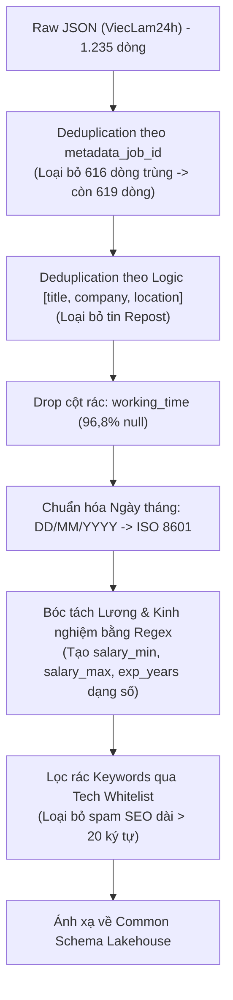

# Báo cáo EDA dữ liệu tuyển dụng ViecLam24h

---

## 1. Tóm tắt điều hành

Báo cáo này trình bày kết quả phân tích khám phá dữ liệu (Exploratory Data Analysis - EDA) và đánh giá chất lượng dữ liệu (Data Quality Assessment) đối với tập dữ liệu tuyển dụng công nghệ thông tin thu thập từ cổng tuyển dụng **ViecLam24h** (thuộc dự án *VN-IT-Job-Mining*). Dữ liệu được trích xuất từ 620 tệp JSON cào ngày 20/10/2026, đóng vai trò là một trong 3 nguồn dữ liệu lớn phục vụ đề tài "Khai phá nhu cầu tuyển dụng và xu hướng kỹ năng ngành IT".

### Tóm tắt các chỉ số cốt lõi:
- **Quy mô tập dữ liệu**: 1.235 bản ghi và 42 trường thuộc tính (sau khi bóc tách, nhúng khối metadata vào payload và làm phẳng bằng `pd.json_normalize`).
- **Độ hoàn thiện (Completeness)**: Dữ liệu đạt tỷ lệ hoàn thiện cực kỳ ấn tượng trên hầu hết các trường nghiệp vụ: 38/42 trường đạt độ đầy đủ 100%. Trường thiếu nghiêm trọng nhất là `working_time` (thời gian làm việc) với **96,76%** giá trị rỗng (1.195/1.235 dòng). Ngược lại, mức lương (`salary`) chỉ thiếu **4,53%** (56/1.235 dòng) ngay cả khi đã lọc null marker trá hình ("Thỏa thuận"), chứng minh ViecLam24h là sàn có tỷ lệ công khai dải lương cao vượt trội. Các trường quy mô công ty (`company_size`) chỉ thiếu 0,97% (12 dòng) và phúc lợi (`benefits`) thiếu 0,49% (6 dòng).
- **Tính hợp lệ & Schema (Validity)**: Toàn bộ 41 trường thuộc tính (ngoại trừ `metadata_version` kiểu `int64`) đều lưu ở kiểu `object`. Cột ngày tháng gồm `deadline` (hạn nộp) và `general_info_posted_date` (ngày đăng) đều đạt chuẩn định dạng Việt Nam `DD/MM/YYYY` 100% (1.235/1.235 bản ghi). Cột lương `salary` và số năm kinh nghiệm `experience_summary` bị chuỗi hóa phức hợp chứa văn bản ("12 - 20 triệu", "1 năm"). Cấu trúc mảng văn bản (`description`, `requirements`, `benefits`, `keywords`, `general_info_workplaces`) đều là các danh sách chuỗi phẳng sạch sẽ (`list of str`), rất thuận lợi cho xử lý NLP.
- **Phân phối lương (Salary Distribution)**: Bóc tách thành công giá trị số từ hơn 95% tin tuyển dụng. Phân phối lương gốc mang đặc tính lệch phải (Right-skewed) với dải lương phổ biến từ 10 - 25 triệu VNĐ/tháng. Phép biến đổi $\log(1 + \text{Lương})$ bình thường hóa phân phối rõ rệt.
- **Tính duy nhất & Trùng lặp (Uniqueness - VẤN ĐỀ NGHIÊM TRỌNG)**: Phát hiện hiện tượng trùng lặp ở mức báo động đỏ: **616 bản ghi trùng lặp tuyệt đối (49,88%)**, trùng khớp hoàn toàn với số lượng trùng mã khóa định danh `metadata_job_id` (**49,88%**). Trùng lặp logic theo `[title, company_name, location_summary]` lên tới **619 bản ghi (50,12%)**. Điều này chứng minh tập dữ liệu thực tế chỉ có khoảng **619 tin tuyển dụng duy nhất**, do crawler bị vòng lặp phân trang (pagination loop) dẫn đến cào lặp gần một nửa.
- **Thiên lệch & Cân bằng (Bias & Balance)**: Cực kỳ mất cân bằng về cấp bậc nhân sự với tỷ lệ lệch cấp bậc lên tới **555,5 lần**: Cấp bậc "Nhân viên" chiếm tới **90,0%** (1.111 tin), trong khi cấp "Giám đốc" chỉ chiếm 0,2% (2 tin). Về địa lý, TP.HCM chiếm 40,3% (498 tin) và Hà Nội chiếm 27,9% (345 tin). Phân bố kỹ năng từ `keywords` (sau khi lọc chuỗi rác dài $\le 20$ ký tự) ghi nhận 8.598 tags, 921 kỹ năng duy nhất, với top 318 kỹ năng (34,5%) chiếm 80% tổng tần suất theo Pareto.
- **Tương quan định lượng (Spearman Correlation)**: Lương tối thiểu và số năm kinh nghiệm có tương quan dương trung bình ($r_s = 0,49$); lương tối thiểu và tối đa tương quan $r_s = 0,59$; độ dài mô tả công việc có tương quan dương vừa phải với kinh nghiệm ($r_s = 0,39$) và lương tối thiểu ($r_s = 0,32$). Số lượng thẻ kỹ năng (`Total_Skills_Count`) hầu như không có tương quan với mức lương ($r_s \approx 0,00$).

---

## 2. Mục tiêu và phạm vi EDA

### 2.1. Mục tiêu
1. Đo lường các chỉ số chất lượng dữ liệu của ViecLam24h phục vụ bài toán khai phá xu hướng tuyển dụng IT.
2. Kiểm tra độ chuẩn hóa của các trường thời gian, phân tích đặc tính cấu trúc mảng và đánh giá khả năng trích xuất lương định lượng.
3. Làm rõ mức độ trùng lặp dữ liệu, chỉ ra nguyên nhân kỹ thuật và thiết kế thuật toán deduplication chính xác.
4. Đo lường thiên lệch cấp bậc, địa lý và phân bố kỹ năng để định hướng các bước tiền xử lý trước khi tích hợp vào Lakehouse.

### 2.2. Phạm vi
- **Nguồn dữ liệu**: 620 tệp JSON raw thu thập ngày 20/10/2026 tại thư mục `data/raw/vieclam24h/2026-10-20/`.
- **Đối tượng**: 1.235 bản ghi trong DataFrame `df_vieclam24h` được sinh ra từ notebook `reports/EDA_vieclam24h.ipynb`.

---

## 3. Nguồn dữ liệu và tổng quan DataFrame

Notebook áp dụng quy trình gộp dữ liệu xử lý thông minh: đọc từng tệp JSON trong thư mục, nhúng thông tin định danh từ khối `metadata` vào `raw_payload` (nhằm bảo toàn `metadata_job_id` và `metadata_source_url`), sau đó gọi `pd.json_normalize(raw_payloads, sep='_')`.

- **Số lượng bản ghi đầu vào**: 1.235 dòng
- **Số lượng trường thuộc tính**: 42 cột
- **Phân loại kiểu dữ liệu (dtypes)**:
  - `int64` (1 cột): `metadata_version`.
  - `object` (41 cột): Gồm các chuỗi văn bản, ngày tháng, dải lương và mảng danh sách (`list`).

### Bảng các nhóm trường dữ liệu chính:

| Phân nhóm | Tên trường tiêu biểu | Ý nghĩa nghiệp vụ |
|---|---|---|
| **Định danh & Kiểm tra** | `metadata_job_id`, `metadata_source_url`, `metadata_content_hash`, `metadata_canonical_hash` | Mã tin, URL gốc, mã băm nội dung để quản lý CDC |
| **Công việc & Doanh nghiệp** | `title`, `company_name`, `company_address`, `company_size` | Tiêu đề tin, tên doanh nghiệp, địa chỉ trụ sở, quy mô nhân sự |
| **Lương & Đãi ngộ** | `salary`, `benefits`, `working_time` | Dải lương chuỗi, danh sách chế độ phúc lợi, giờ làm việc |
| **Mô tả & Yêu cầu** | `description`, `requirements`, `experience_summary`, `general_info_experience` | Mảng mô tả công việc, mảng yêu cầu ứng viên, số năm kinh nghiệm |
| **Thời gian & Cấp bậc** | `general_info_posted_date`, `deadline`, `general_info_level`, `general_info_working_type` | Ngày đăng tuyển, hạn nộp hồ sơ, cấp bậc chuyên môn, hình thức làm việc |
| **Kỹ năng & Địa bàn** | `keywords`, `location_summary`, `general_info_workplaces`, `general_info_industries` | Mảng từ khóa kỹ năng SEO, địa phương tóm tắt, địa điểm làm việc cụ thể |

---

## 4. Phương pháp kiểm tra dữ liệu

### 4.1. Độ hoàn thiện và dữ liệu thiếu (Data Completeness)

#### Phương pháp kiểm tra:
Hàm `clean_hidden_nulls` quét toàn bộ bảng và chuyển đổi các null marker trá hình sau về `np.nan`:
- Chuỗi text: `["", " ", "N/A", "n/a", "null", "Null", "NULL", "None", "none", "Chưa cập nhật", "Đang cập nhật", "Thỏa thuận", "Thoả thuận", "Thương lượng"]`.
- Toàn bộ các mảng danh sách/từ điển rỗng `[]` và `{}`.

#### Bảng thống kê khuyết thiếu thực tế từ notebook:

| Tên trường thuộc tính | Số lượng khuyết thiếu (Missing Count) | Tỷ lệ khuyết thiếu (Missing %) | Đánh giá hiện trạng |
|---|---|---|---|
| `working_time` | 1.195 | 96,76% | Hầu như không có dữ liệu (96,76% rỗng) |
| `salary` | 56 | 4,53% | Chỉ thiếu 4,53% (kể cả đã tính tin Thỏa thuận) |
| `company_size` | 12 | 0,97% | Rất đầy đủ (chỉ thiếu 12 tin) |
| `benefits` | 6 | 0,49% | Rất đầy đủ (chỉ thiếu 6 tin) |
| **38 cột còn lại** | **0** | **0,00%** | **Đầy đủ 100% dữ liệu** |

> [!NOTE]
> Điểm sáng nổi bật của dữ liệu ViecLam24h là mức độ đầy đủ của cột `salary`: có tới **95,47% tin tuyển dụng có công khai dải lương** cụ thể bằng con số, cao hơn rất nhiều so với TopDev (chỉ ~40% có lương số).

---

### 4.2. Tính hợp lệ và kiểu dữ liệu (Validity & Schema Types)

Notebook kiểm tra qua 4 hàm chẩn đoán chi tiết:

1. **Chuẩn hóa ngày tháng**:
   - Hai trường thời gian quan trọng là `deadline` và `general_info_posted_date` được kiểm tra bằng regex định dạng Việt Nam `^\d{2}/\d{2}/\d{4}$`.
   - Kết quả: Cả 2 cột đều đạt **1.235/1.235 bản ghi hợp lệ 100%**, không có định dạng rác hay chuỗi tương đối (ví dụ: "31/10/2026", "29/09/2026"). Khi nạp vào Lakehouse, chỉ cần chuyển đổi sang chuẩn ISO 8601 (`YYYY-MM-DD`).
2. **Số học bị chuỗi hóa (Numeric Strings)**:
   - Cột `salary`: Lưu dạng `object` với các chuỗi khoảng lương ("12 - 20 triệu", "8 - 12 triệu", "20 - 25 triệu"). Cần Regex để bóc tách thành 2 cột số: `salary_min` và `salary_max`.
   - Cột `experience_summary`: Lưu dạng `object` chứa chữ "năm" ("1 năm", "2 năm"). Cần loại bỏ chữ, quy đổi "Chưa có kinh nghiệm" thành 0 để ép về kiểu `int`.
3. **Cấu trúc mảng danh sách (Complex Structures)**:
   - Các cột `description`, `requirements`, `benefits`, `keywords`, `general_info_workplaces` đều có kiểu bề mặt là `list` và cấu trúc bên trong là `list of str`.
   - Đây là mảng phẳng chuỗi sạch sẽ, không bị serialize thành string (`"['A', 'B']"`), không chứa dict lồng nhau, rất thuận tiện cho bước tiền xử lý NLP.

---

### 4.3. Phân phối lương (Salary Distribution)

#### Cơ chế bóc tách:
Hàm `extract_max_salary` xử lý:
- Bỏ qua các tin chứa cụm `"thỏa thuận"`, `"thương lượng"`, `"cạnh tranh"`.
- Chuẩn hóa dấu phẩy thành dấu chấm phân cách thập phân.
- Dùng `re.findall(r'\d+\.?\d*', val)` lấy danh sách số thực, chọn giá trị lớn nhất `max_val` làm lương trần.
- Quy đổi về đơn vị Triệu VNĐ: Nếu $\text{max\_val} \ge 1.000$ (do nhập hàng triệu đầy đủ, VD: 20000000), chia cho $1.000.000$.
- Lọc bỏ ngoại lai phi lý: $\text{max\_val} \le 0$ hoặc $> 500$ triệu VNĐ.

#### Kết quả thực tế:
- Hàm thực thi thành công trên toàn bộ tập dữ liệu và lưu biểu đồ tại `reports/figures/vieclam24h/02_salary_distribution_skewness.png`.
- Phân phối lương gốc có độ lệch dương (lệch phải), tập trung mật độ cao nhất ở phân khúc 12 - 25 triệu VNĐ/tháng.
- Biểu đồ bên phải áp dụng $\log(1 + \text{Lương})$ đưa dữ liệu về dạng tiệm cận chuẩn, loại bỏ hiệu ứng kéo đuôi của các mức lương cao.

---

### 4.4. Tính duy nhất và trùng lặp (Uniqueness & Duplication)

Hàm `check_duplication_v24` ghi nhận kết quả bất thường và mang tính quyết định:

| Cấp độ kiểm tra | Cột căn cứ | Số lượng trùng | Tỷ lệ trùng (%) | Nhận định kỹ thuật |
|---|---|---|---|---|
| **Trùng lặp tuyệt đối (Exact)** | 100% cột trong bảng | 616 bản ghi | **49,88%** | Gần một nửa tập dữ liệu bị lặp từng byte |
| **Trùng lặp khóa định danh (ID)** | `metadata_job_id` | 616 bản ghi | **49,88%** | 616 tin bị trùng lặp ID chính xác |
| **Trùng lặp logic (Semantic)** | `title + company_name + location_summary` | 619 bản ghi | **50,12%** | Thêm 3 tin do HR repost cùng vị trí |

#### Phân tích nguyên nhân và rủi ro:
- Tỷ lệ trùng lặp 49,88% (616/1.235) là minh chứng rõ ràng cho việc **crawler bị cào lặp trang (pagination loop duplicate)** trong phiên cào ngày 20/10/2026. Số lượng tin tuyển dụng thực sự độc lập của sàn chỉ là **619 tin** ($1.235 - 616$).
- **Hành động bắt buộc**: Phải chạy `drop_duplicates(subset=['metadata_job_id'], keep='last')` ngay ở đầu pipeline tiền xử lý để loại bỏ triệt để 616 bản ghi trùng thừa này trước khi phân tích thống kê tiếp theo.

---

### 4.5. Thiên lệch và phân bố dữ liệu (Bias & Balance Profiling)

#### 1. Mất cân bằng Cấp bậc (Seniority Bias):
Tổng hợp từ trường `general_info_level`:
- **Nhân viên**: 1.111 tin (**90,0%**)
- **Cộng tác viên**: 42 tin (**3,4%**)
- **Trưởng phòng**: 30 tin (**2,4%**)
- **Chuyên gia**: 26 tin (**2,1%**)
- **Trưởng nhóm**: 24 tin (**1,9%**)
- **Giám đốc**: 2 tin (**0,2%**)
- **Chỉ số mất cân bằng (Imbalance Ratio)**: $\frac{1.111}{2} = \mathbf{555,5\times}$!

> Tỷ lệ mất cân bằng cấp bậc lên tới 555 lần cho thấy ViecLam24h là sàn tuyển dụng tập trung chủ yếu vào phân khúc nhân sự thực thi đại trà ("Nhân viên"), hầu như không đại diện được cho phân khúc quản lý cấp cao hoặc lãnh đạo công nghệ.

#### 2. Thiên lệch Địa lý (Geographic Bias):
Tổng hợp từ trường `location_summary`:
- **TP.HCM**: 498 tin (**40,3%**)
- **Hà Nội**: 345 tin (**27,9%**)
- **Đà Nẵng**: 62 tin (**5,0%**)
- **Tây Ninh**: 32 tin (**2,6%**)
- **Vĩnh Long**: 28 tin (**2,3%**)
- Các tỉnh thành khác chiếm tỷ lệ nhỏ.

> Khác với TopDev (Hà Nội chiếm tới 38,4%), trên ViecLam24h thị trường TP.HCM chiếm ưu thế vượt trội (40,3% so với 27,9% của Hà Nội), đồng thời có sự hiện diện của các tỉnh vệ tinh miền Tây và Đông Nam Bộ (Tây Ninh, Vĩnh Long).

#### 3. Chẩn đoán Kỹ năng từ `keywords` (Pareto 80/20):
Notebook xây dựng bộ lọc rác loại bỏ các keyword có độ dài $> 20$ ký tự (nhằm loại bỏ tên công ty hoặc mô tả công việc bị HR nhồi nhét vào từ khóa SEO):
- **Tổng số tags hợp lệ**: 8.598 tags
- **Số lượng kỹ năng duy nhất**: 921 kỹ năng
- **Quy luật Pareto (80/20)**: Nhóm **top 318 kỹ năng** (chiếm **34,5%** số kỹ năng duy nhất) chiếm giữ **80%** tổng nhu cầu tuyển dụng.
- **Cảnh báo chất lượng**: Trường `keywords` của ViecLam24h chứa rất nhiều nhiễu SEO (như "tư vấn", "kinh doanh", "nhân viên văn phòng"). Bắt buộc phải có bộ từ điển lọc chuẩn cho ngành CNTT.

---

### 4.6. Phân tích tương quan (Correlation Analysis)

#### Các biến định lượng được trích xuất:
1. `Salary_Min_M`: Lương tối thiểu (Triệu VNĐ), trích xuất qua `extract_salary_min_max`.
2. `Salary_Max_M`: Lương tối đa (Triệu VNĐ), trích xuất qua `extract_salary_min_max`.
3. `Years_of_Experience`: Số năm kinh nghiệm, trích xuất qua `extract_experience_years`.
4. `Total_Skills_Count`: Số lượng thẻ kỹ năng gắn trong `keywords` (`len(keywords)`).
5. `JD_Word_Count`: Tổng số từ trong mô tả công việc (`len(description) + len(requirements)`).

#### Bảng ma trận tương quan hạng Spearman thực tế từ output notebook:

| Thuộc tính định lượng | Salary_Min_M | Salary_Max_M | Years_of_Experience | Total_Skills_Count | JD_Word_Count |
|---|:---:|:---:|:---:|:---:|:---:|
| **Salary_Min_M** | **1,0000** | 0,5875 | 0,4892 | 0,0038 | 0,3230 |
| **Salary_Max_M** | 0,5875 | **1,0000** | 0,2792 | 0,0135 | 0,1526 |
| **Years_of_Experience** | 0,4892 | 0,2792 | **1,0000** | -0,0889 | 0,3907 |
| **Total_Skills_Count** | 0,0038 | 0,0135 | -0,0889 | **1,0000** | 0,0257 |
| **JD_Word_Count** | 0,3230 | 0,1526 | 0,3907 | 0,0257 | **1,0000** |

#### Diễn giải khoa học:
- **Lương sàn và Kinh nghiệm ($r_s = 0,4892$)**: Tương quan dương mức độ trung bình khá mạnh. Điều này phản ánh thực tế thị trường: số năm kinh nghiệm là thước đo quan trọng nhất quyết định mức lương tối thiểu (mức đáy đàm phán) mà nhà tuyển dụng cam kết cho ứng viên.
- **Kinh nghiệm và Độ dài JD ($r_s = 0,3907$)**: Các vị trí đòi hỏi nhiều năm kinh nghiệm thường có bản mô tả công việc và yêu cầu trách nhiệm dài hơn, chi tiết hơn.
- **Số lượng kỹ năng và Mức lương ($r_s \approx 0,00$)**: Hệ số tương quan giữa `Total_Skills_Count` và `Salary_Min_M` ($0,0038$) cũng như `Salary_Max_M` ($0,0135$) gần như bằng 0. Số lượng từ khóa gắn trên ViecLam24h không phản ánh giá trị kỹ thuật hay độ phức tạp của vị trí, chủ yếu do nhà tuyển dụng gắn tag nhằm tối ưu hóa tìm kiếm (SEO spam).

---

## 5. Danh mục biểu đồ và diễn giải

Tất cả các tệp hình ảnh dưới đây đã được xác minh sự tồn tại thực tế tại thư mục `reports/figures/vieclam24h/`:

### 5.1. Biểu đồ 1: Tỷ lệ khuyết thiếu toàn bộ các cột
- **Đường dẫn**: `figures/vieclam24h/01_data_completeness_bar_all.png`
- **Hình ảnh nhúng**:
  
- **Diễn giải**: Biểu đồ thanh ngang chỉ hiển thị 4 cột có khuyết thiếu: `working_time` chiếm vị trí cao nhất (96,8%), theo sau là `salary` (4,5%), `company_size` (1,0%) và `benefits` (0,5%). Trực quan hóa cho thấy độ phủ dữ liệu của ViecLam24h rất cao trên 90% số trường.

### 5.2. Biểu đồ 2: Phân phối lương và chẩn đoán độ lệch
- **Đường dẫn**: `figures/vieclam24h/02_salary_distribution_skewness.png`
- **Hình ảnh nhúng**:
  
- **Diễn giải**: Subplot bên trái thể hiện phân phối dải lương gốc với đường trung bình (Mean) và trung vị (Median). Subplot bên phải là phân phối chuẩn hóa bằng hàm $\log(1 + \text{Lương})$, loại bỏ hiện tượng lệch phải giúp đáp ứng giả định của các thuật toán phân tích hồi quy.

### 5.3. Biểu đồ 3: Phân phối tần suất kỹ năng & Pareto (đã lọc rác)
- **Đường dẫn**: `figures/vieclam24h/03_skills_pareto_distribution.png`
- **Hình ảnh nhúng**:
  
- **Diễn giải**: Biểu đồ kết hợp cột và đường thể hiện Top 20 từ khóa kỹ năng hợp lệ (sau khi lọc chuỗi $>20$ ký tự). Đường cong màu đỏ thể hiện tỷ lệ tích lũy cắt ngưỡng 80%, khẳng định quy luật tập trung nhu cầu vào nhóm kỹ năng cốt lõi.

### 5.4. Biểu đồ 4: Chẩn đoán mất cân bằng lớp (Cấp bậc & Địa lý)
- **Đường dẫn**: `figures/vieclam24h/04_bias_and_class_balance.png`
- **Hình ảnh nhúng**:
  
- **Diễn giải**: Subplot bên trái là Bar chart ngang thể hiện sự thống trị tuyệt đối của cấp bậc "Nhân viên" (90%) với tỷ lệ mất cân bằng 555,5x. Subplot bên phải là Donut chart địa lý với hai mảng lớn nhất thuộc về TP.HCM (40,3%) và Hà Nội (27,9%).

### 5.5. Biểu đồ 5: Ma trận tương quan hạng Spearman
- **Đường dẫn**: `figures/vieclam24h/05_spearman_correlation_matrix.png`
- **Hình ảnh nhúng**:
  
- **Diễn giải**: Heatmap nửa tam giác dưới hiển thị đầy đủ các hệ số tương quan thực tế giữa 5 biến định lượng (`Salary_Min_M`, `Salary_Max_M`, `Years_of_Experience`, `Total_Skills_Count`, `JD_Word_Count`), trực quan hóa trực tiếp giá trị bảng số đã phân tích ở mục 4.6.

---

## 6. Các vấn đề chất lượng dữ liệu cần xử lý

Tổng hợp các phát hiện then chốt theo cấu trúc: **Phát hiện → Bằng chứng/số liệu → Ý nghĩa → Đề xuất xử lý**.

---

### Vấn đề 1: Trùng lặp dữ liệu nghiêm trọng do lỗi crawler lặp trang
- **Phát hiện**: Gần một nửa tập dữ liệu bị trùng lặp byte-to-byte và trùng mã định danh bài đăng.
- **Bằng chứng/số liệu**: 616 bản ghi trùng lặp tuyệt đối (**49,88%**) và trùng `metadata_job_id` (**49,88%**).
- **Ý nghĩa**: Nếu không loại bỏ bản ghi trùng, toàn bộ các phép đếm tần suất kỹ năng, phân phối lương và mô hình dự báo sẽ bị nhân đôi trọng số sai lệch, làm méo mó kết quả phân tích.
- **Đề xuất xử lý**:
  - Thực thi ngay lập tức lệnh `df.drop_duplicates(subset=['metadata_job_id'], keep='first')` ở bước đầu tiên của tiền xử lý.
  - Sau đó tiếp tục chạy `df.drop_duplicates(subset=['title', 'company_name', 'location_summary'], keep='last')` để lọc nốt 3 tin trùng logic còn lại.

---

### Vấn đề 2: Cột thời gian làm việc rỗng gần như toàn bộ
- **Phát hiện**: Cột `working_time` hầu như không có dữ liệu hữu ích.
- **Bằng chứng/số liệu**: 1.195 bản ghi null (**96,76%**).
- **Ý nghĩa**: Cột này chiếm dung lượng lưu trữ nhưng không cung cấp thông tin thống kê có ý nghĩa.
- **Đề xuất xử lý**: Loại bỏ (drop) cột `working_time` khỏi schema phục vụ khai phá dữ liệu.

---

### Vấn đề 3: Từ khóa kỹ năng (`keywords`) bị nhiễm rác và spam SEO
- **Phát hiện**: Cột `keywords` chứa nhiều chuỗi văn bản dài là tiêu đề công việc hoặc tên doanh nghiệp thay vì tên kỹ năng công nghệ chuẩn.
- **Bằng chứng/số liệu**: Notebook phải đặt bộ lọc `str.len() <= 20` mới thu được 8.598 tags hợp lệ; trước khi lọc, xuất hiện các keyword như *"Công Ty Cổ Phần Công ..."*, *"nhân viên kinh doanh thị trường"*.
- **Ý nghĩa**: Gây nhiễu nặng cho các mô hình trích xuất luật kết hợp (Association Rules), dẫn đến việc sinh ra các luật rác (spurious rules).
- **Đề xuất xử lý**:
  - Xây dựng bộ lọc từ điển CNTT (Tech Skill Whitelist) để chỉ giữ lại các keyword khớp với danh mục công nghệ chuẩn (Python, Java, React, Docker, v.v.).
  - Bổ sung bước trích xuất kỹ năng bằng NLP từ mảng `requirements` và `description`.

---

### Vấn đề 4: Mất cân bằng cấp bậc nhân sự cực đoan
- **Phát hiện**: Cấp bậc "Nhân viên" chiếm tới 90% dữ liệu, tỷ lệ mất cân bằng giữa cấp cao nhất và thấp nhất là 555,5 lần.
- **Bằng chứng/số liệu**: 1.111 tin "Nhân viên" so với 2 tin "Giám đốc" và 24 tin "Trưởng nhóm".
- **Ý nghĩa**: Không thể sử dụng tập dữ liệu ViecLam24h đơn lẻ để xây dựng mô hình phân loại cấp bậc hoặc dự báo lương cho phân khúc quản lý IT.
- **Đề xuất xử lý**:
  - Khi tích hợp đa nguồn (Data Integration), kết hợp dữ liệu ViecLam24h với các nguồn có phân khúc cao hơn như VietnamWorks và TopDev.
  - Sử dụng các kỹ thuật cân bằng dữ liệu (Resampling / Class Weights) nếu huấn luyện mô hình phân loại cấp bậc.

---

## 7. Đề xuất tiền xử lý và tích hợp dữ liệu



### Các bước cụ thể:
1. **Khử trùng lặp**:
   ```python
   df_clean = df_vieclam24h.drop_duplicates(subset=['metadata_job_id'], keep='first')
   df_clean = df_clean.drop_duplicates(subset=['title', 'company_name', 'location_summary'], keep='last')
   ```
2. **Chuẩn hóa ngày tháng**:
   Chuyển đổi `deadline` và `general_info_posted_date` từ `DD/MM/YYYY` sang chuẩn `YYYY-MM-DD` bằng `pd.to_datetime(..., format='%d/%m/%Y')`.
3. **Bóc tách trường số học**:
   - Áp dụng `extract_salary_min_max` để tạo `salary_min_vnd` và `salary_max_vnd` (Triệu VNĐ).
   - Áp dụng `extract_experience_years` để chuyển đổi `experience_summary` thành `experience_years` (kiểu `float`).
4. **Lọc từ khóa kỹ năng**:
   Áp dụng bộ từ điển kỹ năng chuẩn hóa nhằm tách lọc các kỹ năng CNTT hợp lệ từ trường `keywords`.

---

## 8. Khả năng khai phá dữ liệu và hướng phân tích tiếp theo

1. **Phân tích mối quan hệ Kinh nghiệm - Mức lương**:
   - Với tương quan $r_s = 0,49$ giữa kinh nghiệm và lương sàn, tập dữ liệu ViecLam24h là nguồn minh chứng thực nghiệm tốt cho bài toán hồi quy định giá lao động theo số năm kinh nghiệm ở phân khúc nhân sự phổ thông.
2. **Khai phá luật kết hợp kỹ năng (FP-Growth)**:
   - Áp dụng trên tập từ khóa sau khi lọc rác để tìm ra các nhóm kỹ năng nền tảng trong tuyển dụng IT đại trà.
3. **So sánh thị trường lao động liên vùng**:
   - So sánh cơ cấu mức lương và yêu cầu công nghệ giữa TP.HCM (40,3%) và Hà Nội (27,9%) cũng như các tỉnh vệ tinh miền Tây.

---

## 9. Hạn chế của EDA

1. **Tập dữ liệu hiệu dụng thực tế nhỏ**: Do 49,88% bản ghi là trùng lặp tuyệt đối, kích thước mẫu thực sự sau khử trùng chỉ còn khoảng 619 tin, làm giảm độ mạnh thống kê (Statistical Power) của các phép phân tích chuyên sâu.
2. **Nhiễu từ khóa SEO**: Trường `keywords` của ViecLam24h không phản ánh thuần túy kỹ năng lập trình mà bị pha tạp các từ khóa bán hàng, hành chính do tính chất đa ngành của sàn.
3. **Thiếu vắng phân khúc Senior/Lead**: Dữ liệu gần như bị bao phủ bởi cấp bậc "Nhân viên", dẫn đến góc nhìn phiến diện nếu chỉ phân tích thị trường IT qua ViecLam24h mà không đối chiếu với TopDev hay VietnamWorks.

---

## 10. Kết luận

Phân tích EDA tập dữ liệu **ViecLam24h** ($N = 1.235$) đã làm sáng tỏ những thế mạnh vượt trội và những điểm nghẽn nghiêm trọng:
- **Thế mạnh**: Tỷ lệ công khai dải lương cực kỳ cao (>95% có số liệu), định dạng ngày tháng chuẩn chỉnh 100%, cấu trúc mảng văn bản phẳng và sạch.
- **Hạn chế then chốt**: Tỷ lệ trùng lặp do lỗi thu thập chạm mức 50%, cấp bậc bị mất cân bằng trầm trọng (90% là nhân viên) và từ khóa kỹ năng chứa nhiều tạp âm SEO.

Sau khi thực hiện quy trình khử trùng lặp và lọc rác như đã đề xuất, tập dữ liệu ViecLam24h với ~619 tin tuyển dụng sạch sẽ là mảnh ghép quan trọng bổ sung cho phân khúc việc làm IT thực thi, tạo nên bức tranh toàn cảnh khi tích hợp cùng TopDev và VietnamWorks trong dự án.
