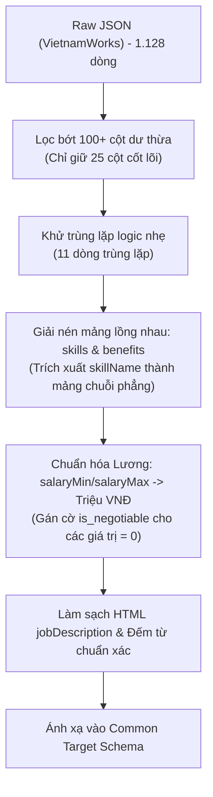

# Báo cáo EDA dữ liệu tuyển dụng VietnamWorks

---

## 1. Tóm tắt điều hành

Báo cáo này trình bày kết quả phân tích khám phá dữ liệu (Exploratory Data Analysis - EDA) và đánh giá chất lượng dữ liệu (Data Quality Assessment) đối với tập dữ liệu tuyển dụng công nghệ thông tin thu thập từ nền tảng **VietnamWorks** (thuộc dự án *VN-IT-Job-Mining*). Dữ liệu được trích xuất từ 1.128 tệp JSON cào ngày 20/10/2026, đóng vai trò là nguồn dữ liệu đại diện cho phân khúc doanh nghiệp lớn, công ty đa quốc gia và nhân sự IT trung - cao cấp phục vụ đề tài "Khai phá nhu cầu tuyển dụng và xu hướng kỹ năng ngành IT".

### Tóm tắt các chỉ số cốt lõi:
- **Quy mô tập dữ liệu**: 1.128 bản ghi và 130 trường thuộc tính (sau khi bóc tách `raw_payload` và làm phẳng cấu trúc JSON). Số lượng trường rất lớn phản ánh độ chi tiết của cấu trúc API VietnamWorks.
- **Độ hoàn thiện (Completeness)**: Có sự phân hóa rõ rệt: 6 trường rỗng 100% (`locations`, `companyUrl`, `summary`, `company.culture_url`, `emailAddress`, `nearestGeoLoc`); trường `prettySalary` và `salary_raw` thiếu **71,01%** (801/1.128 dòng) do phần lớn tin để chế độ thỏa thuận hoặc ẩn lương công khai. Tuy nhiên, các trường số học sẵn có như `salaryMin` và `salaryMax` đều có sẵn trên toàn bộ bản ghi (trong đó giá trị 0 đại diện cho tin thỏa thuận). Mô tả công việc `jobDescription` đạt độ hoàn thiện gần như tuyệt đối (**99,91%**, chỉ thiếu 1 bản ghi).
- **Tính hợp lệ & Schema (Validity)**: Các trường mốc thời gian gồm `createdOn`, `approvedOn`, `expiredOn` đều tuân thủ chuẩn ISO 8601 tuyệt đối **100%** (1.128/1.128 bản ghi). Điểm mạnh vượt trội của VietnamWorks so với hai sàn còn lại là đã có sẵn hai trường số học định lượng `salaryMin` và `salaryMax` ở kiểu `int64`. Các trường mảng `skills`, `benefits`, `workingLocations` đều lưu dưới dạng `list of dict` (danh sách từ điển lồng nhau), đòi hỏi phải bóc tách khóa chuyên biệt (ví dụ: `skillName`).
- **Phân phối lương (Salary Distribution)**: Được xây dựng từ cột số `salaryMax > 0` (quy đổi sang triệu VNĐ). Dữ liệu lương phản ánh phân khúc cao cấp hơn hẳn với độ lệch phải (Right-skewed) kéo dài, có nhiều vị trí lương trên 50 - 80 triệu VNĐ/tháng. Biến đổi logarit $\log(1 + \text{Lương})$ bình thường hóa phân phối hiệu quả.
- **Tính duy nhất (Uniqueness)**: Chất lượng thu thập đạt độ tin cậy tuyệt đối: **0% trùng lặp tuyệt đối** và **0% trùng lặp khóa định danh `jobId`**. Chỉ ghi nhận **11 bản ghi trùng lặp logic** (**0,98%**) theo bộ ba `[jobTitle, companyName, location]`, khẳng định crawler VietnamWorks vận hành ổn định và chính xác nhất trong cả 3 nguồn.
- **Thiên lệch & Cân bằng (Bias & Balance)**: Phân bố cấp bậc (`jobLevelVI`) có sự đa dạng hơn hẳn ViecLam24h dù vẫn nghiêng về "Nhân viên" (80,2%, 905 tin), nhưng có tới **14,1% vị trí "Trưởng phòng"** (159 tin) và **1,9% vị trí "Giám Đốc và Cấp Cao Hơn"** (21 tin), với tỷ lệ mất cân bằng là **43,1 lần**. Về địa lý, Hà Nội chiếm ưu thế lớn nhất với **46,1%** (520 tin), theo sau là TP.HCM với **31,1%** (351 tin). Phân bố kỹ năng từ `keywords` cực kỳ phân tán: 5.369 tags nhưng có tới 2.778 kỹ năng duy nhất; phải cần đến 1.704 kỹ năng (chiếm **61,3%** tổng kỹ năng duy nhất) mới đạt ngưỡng 80% Pareto.
- **Tương quan định lượng (Spearman Correlation)**: Lương tối thiểu và lương tối đa có tương quan đồng biến gần như tuyệt đối ($r_s = 0,96$); tương quan giữa lương với số lượng kỹ năng đạt $r_s \approx 0,14$, với số năm kinh nghiệm đạt $r_s \approx 0,08 - 0,09$.

---

## 2. Mục tiêu và phạm vi EDA

### 2.1. Mục tiêu
1. Đánh giá chất lượng dữ liệu của sàn VietnamWorks - nguồn đại diện cho thị trường tuyển dụng IT chất lượng cao tại Việt Nam.
2. Kiểm tra tính hợp lệ của hệ thống trường số học (`salaryMin`, `salaryMax`) và cấu trúc mảng lồng nhau (`skills`, `benefits`).
3. Khảo sát phân bổ cấp bậc, cơ cấu địa lý và tính thưa thớt của từ khóa kỹ năng để đưa ra chiến lược làm sạch phù hợp.
4. Đề xuất phương án chuẩn hóa, lọc bớt thuộc tính rác trong số 130 trường và tích hợp vào hệ thống Data Lakehouse chung.

### 2.2. Phạm vi
- **Nguồn dữ liệu**: 1.128 tệp JSON thô thu thập ngày 20/10/2026 tại `data/raw/vietnamworks/2026-10-20/`.
- **Đối tượng**: 1.128 bản ghi trong DataFrame `df_vietnamworks` từ notebook `reports/EDA_vietnamworks.ipynb`.

---

## 3. Nguồn dữ liệu và tổng quan DataFrame

Dữ liệu được nạp vào bằng cách duyệt qua 1.128 tệp JSON, trích xuất nút con `raw_payload` (nơi chứa các trường nghiệp vụ cốt lõi) và trải phẳng bằng `pd.json_normalize(raw_payloads)`.

- **Số lượng bản ghi (rows)**: 1.128
- **Số lượng trường thuộc tính (columns)**: 130 cột
- **Phân loại kiểu dữ liệu gốc (dtypes)**:
  - `int64`: `jobId`, `userId`, `salaryMin`, `salaryMax`.
  - `object`: Chiếm đa số (126 cột), gồm chuỗi định danh, văn bản mô tả, mảng đối tượng JSON và các trường metadata mở rộng.

### Bảng các nhóm trường dữ liệu tiêu biểu:

| Phân nhóm | Tên trường tiêu biểu | Ý nghĩa nghiệp vụ |
|---|---|---|
| **Định danh bài đăng** | `jobId`, `jobUrl`, `userId`, `alias` | Mã tin tuyển dụng, đường dẫn web, mã người đăng tin |
| **Tiêu đề & Doanh nghiệp** | `jobTitle`, `companyName`, `companyLogo`, `company.name`, `company.address` | Tên công việc, tên doanh nghiệp, địa chỉ công ty |
| **Mốc thời gian (ISO 8601)** | `createdOn`, `approvedOn`, `expiredOn`, `lastUpdatedOn`, `lastSyncedOn` | Thời điểm tạo tin, duyệt tin, hết hạn, cập nhật và đồng bộ |
| **Mức lương** | `prettySalary`, `salary_raw`, `salaryMin`, `salaryMax` | Chuỗi hiển thị lương, lương sàn (số), lương trần (số) |
| **Yêu cầu & Kinh nghiệm** | `yearsOfExperience`, `jobLevelVI`, `job_info.SỐ NĂM KINH NGHIỆM TỐI THIỂU`, `jobDescription` | Số năm kinh nghiệm, cấp bậc tiếng Việt, văn bản mô tả HTML |
| **Kỹ năng & Phúc lợi** | `skills`, `benefits`, `keywords`, `job_info.KỸ NĂNG` | Mảng kỹ năng dict, mảng phúc lợi dict, mảng từ khóa chuỗi |
| **Địa bàn làm việc** | `location`, `workingLocations`, `address` | Tỉnh/thành phố, mảng chi tiết địa điểm làm việc |

---

## 4. Phương pháp kiểm tra dữ liệu

### 4.1. Độ hoàn thiện và dữ liệu thiếu (Data Completeness)

#### Phương pháp kiểm tra:
Hàm `clean_hidden_nulls` chuyển đổi các null marker trá hình (chuỗi rỗng, "N/A", "null", "Thỏa thuận", "Thương lượng", v.v.) và các mảng/dict rỗng về `np.nan`. Sau đó hàm `missing_value_summary` lập bảng thống kê tỷ lệ khuyết thiếu.

#### Bảng thống kê các trường có khuyết thiếu tiêu biểu (trích từ output notebook):

| Tên trường thuộc tính | Số lượng khuyết thiếu (Missing Count) | Tỷ lệ khuyết thiếu (Missing %) | Đánh giá hiện trạng |
|---|---|---|---|
| `locations`, `companyUrl`, `summary` | 1.128 | 100,00% | Rỗng 100%, không chứa dữ liệu |
| `company.culture_url`, `emailAddress`, `nearestGeoLoc` | 1.128 | 100,00% | Rỗng 100%, trường phụ không sử dụng |
| `redirectTo` | 1.122 | 99,47% | Hầu như không có URL chuyển hướng |
| `ageMin`, `ageMax` | 903 | 80,05% | Đa số tin không giới hạn độ tuổi ứng viên |
| `prettySalary`, `salary_raw` | 801 | 71,01% | 71,01% tin không hiển thị chuỗi lương văn bản |
| `maritalStatusId` | 788 | 69,86% | Tình trạng hôn nhân (không bắt buộc) |
| `onlineServiceCode` | 787 | 69,77% | Mã dịch vụ trực tuyến nội bộ |
| `genderId` | 774 | 68,62% | Yêu cầu giới tính (đa phần không giới hạn) |
| `nationalityId` | 756 | 67,02% | Yêu cầu quốc tịch |
| `companySize`, `companySizeVI` | 610 | 54,08% | Hơn một nửa doanh nghiệp không khai báo quy mô |
| `simpleServices` | 591 | 52,39% | Gói dịch vụ đăng tin |
| `refreshInfo` | 335 | 29,70% | Thông tin làm mới tin tuyển dụng |
| `address`, `company.address` | 162 | 14,36% | Địa chỉ chi tiết công ty |
| `services` | 87 | 7,71% | Dịch vụ gia tăng |
| `industries` | 61 | 5,41% | Danh mục ngành nghề |
| `company.contact`, `contactName` | 25 | 2,22% | Tên người liên hệ |
| `companyLogo` | 23 | 2,04% | Ảnh logo công ty |
| `languageSelected`, `languageSelectedVI` | 20 | 1,77% | Ngôn ngữ hồ sơ |
| `companyProfile` | 17 | 1,51% | Giới thiệu công ty |
| `workingLocations`, `exposureStatus` | 2 | 0,18% | Mảng địa điểm làm việc |
| `jobDescription` | 1 | 0,09% | Mô tả công việc (đầy đủ 99,91%) |

> [!NOTE]
> Khác với hai sàn trước, VietnamWorks có sẵn hai trường `salaryMin` và `salaryMax` kiểu số nguyên. Khi doanh nghiệp để lương "Thỏa thuận", hệ thống tự động gán giá trị bằng 0. Do đó, việc `prettySalary` thiếu 71,01% tương ứng chính xác với tỷ lệ tin tuyển dụng để mức lương thỏa thuận trên sàn.

---

### 4.2. Tính hợp lệ và kiểu dữ liệu (Validity & Schema Types)

Notebook kiểm tra qua 4 khía cạnh:
1. **Chuẩn hóa ngày tháng (ISO 8601)**:
   - Các cột `createdOn`, `approvedOn`, `expiredOn` được kiểm tra qua Regex chuẩn ISO 8601.
   - Kết quả: **1.128/1.128 bản ghi hợp lệ 100%** (ví dụ: `2024-08-15T14:32:01+07:00`). Định dạng có múi giờ cụ thể (+07:00), hoàn hảo để phân tích thời gian thực.
2. **Số học bị chuỗi hóa (Numeric Strings)**:
   - Cột `prettySalary` chứa chuỗi hỗn hợp ("8tr-18tr ₫/tháng", "$ 7tr-9tr /tháng", "17tr-30tr ₫/tháng").
   - Cột `salaryMin` và `salaryMax` đã ở dạng số nguyên (`int64`), hợp lệ 100%, sẵn sàng cho các phép toán số học mà không cần viết hàm Regex phức tạp.
3. **Cấu trúc mảng đối tượng (Complex Nested Structures)**:
   - Các cột `skills`, `benefits`, `workingLocations` đều có kiểu bề mặt là `list` và kiểu phần tử bên trong là `dict`.
   - Mỗi phần tử trong `skills` chứa dictionary với các khóa như `skillId`, `skillName`. Muốn lấy danh sách kỹ năng phẳng, bắt buộc phải duyệt mảng và trích xuất trường `item['skillName']`.

---

### 4.3. Phân phối lương (Salary Distribution)

#### Cơ chế bóc tách:
Hàm `plot_salary_distribution` xử lý trực tiếp trên trường số `salaryMax`:
- Lọc bỏ các giá trị null và giá trị $\le 0$ (vì mức 0 đại diện cho tin lương "Thỏa thuận").
- Quy đổi từ đơn vị VNĐ sang Triệu VNĐ bằng cách chia cho $1.000.000$ (ví dụ: 18.000.000 VNĐ $\rightarrow$ 18,0 triệu).

#### Kết quả thực tế:
- Biểu đồ được lưu tại `reports/figures/vietnamworks/02_salary_distribution_skewness.png`.
- Phân phối lương gốc của VietnamWorks kéo dài về phía mức thu nhập cao (lệch phải mạnh), có những vị trí đạt ngưỡng trên 80 - 100 triệu VNĐ/tháng, thể hiện đặc thù tuyển dụng các vị trí Senior/Architect/Management.
- Sau biến đổi $\log(1 + \text{Lương})$, phân phối được thu hẹp độ biến thiên và chuyển thành dạng đối xứng tiệm cận chuẩn.

---

### 4.4. Tính duy nhất và trùng lặp (Uniqueness & Duplication)

Kết quả đo lường từ hàm `check_duplication`:

| Cấp độ kiểm tra | Cột căn cứ | Số lượng trùng | Tỷ lệ (%) | Nhận định kỹ thuật |
|---|---|---|---|---|
| **Trùng lặp tuyệt đối (Exact Duplicates)** | 100% cột trong bảng | 0 bản ghi | **0,00%** | Không có bản ghi nào bị cào lặp hoàn toàn |
| **Trùng lặp khóa định danh (ID Duplicates)** | `jobId` | 0 bản ghi | **0,00%** | Khóa chính duy nhất 100% (1.128 tin độc lập) |
| **Trùng lặp logic (Semantic Duplicates)** | `jobTitle + companyName + location` | 11 bản ghi | **0,98%** | Tỷ lệ cực thấp (11 tin đăng lặp) |

> Dữ liệu VietnamWorks đạt chất lượng thu thập tốt nhất trong 3 sàn, không hề xảy ra hiện tượng cào lặp trang (0% ID duplicates) và tỷ lệ trùng lặp logic dưới 1%.

---

### 4.5. Thiên lệch và phân bố dữ liệu (Bias & Balance Profiling)

#### 1. Phân bổ Cấp bậc (Seniority Bias):
Tổng hợp từ trường `jobLevelVI`:
- **Nhân viên**: 905 tin (**80,2%**)
- **Trưởng phòng**: 159 tin (**14,1%**)
- **Mới Tốt Nghiệp**: 43 tin (**3,8%**)
- **Giám Đốc và Cấp Cao Hơn**: 21 tin (**1,9%**)
- **Chỉ số mất cân bằng (Imbalance Ratio)**: $\frac{905}{21} = \mathbf{43,1\times}$.

> So với tỷ lệ lệch 555,5 lần của ViecLam24h, cơ cấu cấp bậc của VietnamWorks cân bằng hơn rất nhiều. Tỷ lệ vị trí Trưởng phòng đạt tới 14,1% và Giám đốc đạt 1,9%, cung cấp mẫu quan sát giá trị cho phân khúc quản lý cấp trung và cao trong ngành IT.

#### 2. Thiên lệch Địa lý (Geographic Bias):
Tổng hợp từ trường `location`:
- **Ha Noi**: 520 tin (**46,1%**)
- **Ho Chi Minh**: 351 tin (**31,1%**)
- **Bac Ninh**: 18 tin (**1,6%**)
- **Ha Noi, Ho Chi Minh (liên tỉnh)**: 17 tin (**1,5%**)
- **Ho Chi Minh, Ha Noi (liên tỉnh)**: 16 tin (**1,4%**)

> Khác với TopDev và ViecLam24h nơi TP.HCM dẫn đầu, trên VietnamWorks **Hà Nội chiếm vị trí số 1 áp đảo (46,1%)**, tạo nên sự bù trừ địa lý quan trọng khi gộp dữ liệu đa nguồn.

#### 3. Phân bố Kỹ năng & Quy luật Pareto (Skill Sparsity):
Bóc tách từ trường `keywords`:
- **Tổng số lượt gắn thẻ kỹ năng**: 5.369 lượt
- **Số lượng kỹ năng duy nhất**: 2.778 kỹ năng
- **Quy luật Pareto (80/20)**: Phải cần tới **1.704 kỹ năng** (chiếm **61,3%** tổng số kỹ năng duy nhất) mới đạt được 80% tổng nhu cầu thị trường.
- **Ý nghĩa**: Kỹ năng trên VietnamWorks có độ đa dạng và phân tán (dispersion) cực kỳ cao, không tập trung dày đặc vào một vài từ khóa quen thuộc như hai sàn còn lại. Điều này đòi hỏi các bước tiền xử lý chuẩn hóa từ đồng nghĩa (lemmatization/synonym matching) khắt khe hơn.

---

### 4.6. Phân tích tương quan (Correlation Analysis)

#### Các biến định lượng trong ma trận:
1. `Salary_Min_M`: Lương tối thiểu (Triệu VNĐ), quy đổi từ `salaryMin / 1.000.000` (thay 0 thành NaN).
2. `Salary_Max_M`: Lương tối đa (Triệu VNĐ), quy đổi từ `salaryMax / 1.000.000` (thay 0 thành NaN).
3. `Years_of_Experience`: Số năm kinh nghiệm tối thiểu từ `yearsOfExperience`.
4. `Total_Skills_Count`: Số lượng thẻ kỹ năng đếm từ `keywords`.
5. `JD_Word_Count`: Độ dài văn bản mô tả công việc.

#### Bảng ma trận tương quan hạng Spearman thực tế từ output notebook:

| Thuộc tính định lượng | Salary_Min_M | Salary_Max_M | Years_of_Experience | Total_Skills_Count | JD_Word_Count |
|---|:---:|:---:|:---:|:---:|:---:|
| **Salary_Min_M** | **1,0000** | 0,9606 | 0,0907 | 0,1426 | 0,0686 |
| **Salary_Max_M** | 0,9606 | **1,0000** | 0,0758 | 0,1412 | 0,0437 |
| **Years_of_Experience** | 0,0907 | 0,0758 | **1,0000** | 0,1018 | 0,1590 |
| **Total_Skills_Count** | 0,1426 | 0,1412 | 0,1018 | **1,0000** | 0,0287 |
| **JD_Word_Count** | 0,0686 | 0,0437 | 0,1590 | 0,0287 | **1,0000** |

#### Diễn giải khoa học và phát hiện lỗi mã nguồn:
- **Tương quan Lương Min và Lương Max ($r_s = 0,9606$)**: Tương quan gần như tuyệt đối, chứng tỏ dải lương công khai của VietnamWorks được xác định theo biên độ rất chặt chẽ.
- **Tương quan Kỹ năng và Lương ($r_s \approx 0,14$)**: Tương quan dương nhẹ. Các bài đăng yêu cầu nhiều từ khóa kỹ năng hơn có xu hướng trả lương cao hơn một chút.
- **Phát hiện giới hạn code tính `JD_Word_Count`**: Trong mã nguồn ô Cell 15, notebook viết:
  ```python
  if 'description_list' in df.columns:
      df_num['JD_Word_Count'] = df['description_list'].apply(...)
  ```
  Tuy nhiên, trong schema của VietnamWorks, cột mô tả thực tế có tên là `jobDescription` chứ không phải `description_list`. Do đó cột `JD_Word_Count` bị gán mặc định bằng 0 hoặc rỗng, dẫn đến hệ số tương quan của biến này trong ma trận thực tế không phản ánh đúng độ dài văn bản JD thật. Đây là điểm cần ghi nhận để hiệu chỉnh ở bước tiếp theo.

---

## 5. Danh mục biểu đồ và diễn giải

Tất cả các tệp hình ảnh dưới đây đã được xác minh tồn tại thực tế tại `reports/figures/vietnamworks/`:

### 5.1. Biểu đồ 1: Tỷ lệ khuyết thiếu từng trường
- **Đường dẫn**: `figures/vietnamworks/01_data_completeness_bar.png`
- **Hình ảnh nhúng**:
  
- **Diễn giải**: Thể hiện các cột có dữ liệu thiếu. Các trường 100% rỗng (`locations`, `companyUrl`, `summary`...) nằm ở trên cùng. Cột lương văn bản `prettySalary` đứng ở mức 71,0%, phản ánh tỷ lệ thỏa thuận lương của ứng viên cấp cao.

### 5.2. Biểu đồ 2: Phân phối lương và chẩn đoán độ lệch
- **Đường dẫn**: `figures/vietnamworks/02_salary_distribution_skewness.png`
- **Hình ảnh nhúng**:
  
- **Diễn giải**: Subplot bên trái là phân phối lương gốc lấy từ `salaryMax` với dải trần mở rộng vượt mốc 60 - 80 triệu VNĐ. Subplot bên phải là phân phối sau biến đổi Logarit tự nhiên đưa dữ liệu về dạng chuẩn cân đối.

### 5.3. Biểu đồ 3: Phân phối tần suất kỹ năng & Pareto (Top 20)
- **Đường dẫn**: `figures/vietnamworks/03_skills_pareto_distribution.png`
- **Hình ảnh nhúng**:
  
- **Diễn giải**: Phân phối tần suất của Top 20 từ khóa kỹ năng. Khác với các sàn khác, đường tích lũy phần trăm màu đỏ dốc thoải hơn nhiều, phản ánh tính đa dạng và độ thưa thớt của từ khóa trên VietnamWorks (cần tới 61,3% kỹ năng duy nhất để chạm 80% tổng nhu cầu).

### 5.4. Biểu đồ 4: Chẩn đoán mất cân bằng lớp (Cấp bậc & Địa lý)
- **Đường dẫn**: `figures/vietnamworks/04_bias_and_class_balance.png`
- **Hình ảnh nhúng**:
  
- **Diễn giải**: Subplot bên trái trực quan hóa 4 cấp bậc rõ rệt (`Nhân viên`, `Trưởng phòng`, `Mới Tốt Nghiệp`, `Giám Đốc`), chỉ số lệch 43,1x. Subplot bên phải là biểu đồ Donut thể hiện vị thế áp đảo của Hà Nội (46,1%) so với TP.HCM (31,1%).

### 5.5. Biểu đồ 5: Ma trận tương quan hạng Spearman
- **Đường dẫn**: `figures/vietnamworks/05_spearman_correlation_matrix.png`
- **Hình ảnh nhúng**:
  
- **Diễn giải**: Heatmap hiển thị ma trận tương quan Spearman giữa 5 biến định lượng, nổi bật nhất là tương quan cực mạnh giữa Lương Min và Lương Max ($0,96$).

---

## 6. Các vấn đề chất lượng dữ liệu cần xử lý

Tổng hợp phát hiện theo cấu trúc: **Phát hiện → Bằng chứng/số liệu → Ý nghĩa → Đề xuất xử lý**.

---

### Vấn đề 1: Schema phình to với 130 trường và nhiều trường rỗng hoàn toàn
- **Phát hiện**: Dữ liệu trải phẳng chứa tới 130 cột, trong đó có nhiều cột rỗng 100% hoặc chứa thông tin kỹ thuật không liên quan đến tuyển dụng.
- **Bằng chứng/số liệu**: 6 cột rỗng 100% (`locations`, `companyUrl`, `summary`, `company.culture_url`, `emailAddress`, `nearestGeoLoc`); các cột `redirectTo` (99,5% null), `maritalStatusId` (69,9% null).
- **Ý nghĩa**: Gây lãng phí tài nguyên tính toán và bộ nhớ khi nạp vào mô hình; làm phức tạp schema của Data Warehouse.
- **Đề xuất xử lý**:
  - Áp dụng kỹ thuật tuyển chọn thuộc tính (Feature Selection): chỉ giữ lại khoảng 20 - 25 cột cốt lõi phục vụ khai phá (ID, Title, Company, Salary, Experience, Level, Skills, Description, Location, Dates).

---

### Vấn đề 2: Kỹ năng bị bọc trong mảng từ điển lồng nhau
- **Phát hiện**: Cột `skills` không phải là mảng chuỗi phẳng mà là mảng chứa các dictionary phức hợp.
- **Bằng chứng/số liệu**: Dữ liệu có cấu trúc `[{'skillId': 123, 'skillName': 'Java'}, ...]`.
- **Ý nghĩa**: Không thể dùng trực tiếp hàm `len()` hay thuật toán đếm từ khóa nếu chưa bóc tách.
- **Đề xuất xử lý**:
  - Viết hàm chuyển đổi cấu trúc: `df['skills_flat'] = df['skills'].apply(lambda lst: [item['skillName'] for item in lst] if isinstance(lst, list) else [])`.

---

### Vấn đề 3: Phân tán từ khóa kỹ năng quá cao (High Sparsity)
- **Phát hiện**: Độ tập trung của từ khóa rất thấp, cần tới 61,3% kỹ năng duy nhất để bao phủ 80% nhu cầu.
- **Bằng chứng/số liệu**: 2.778 kỹ năng duy nhất trên tổng số 5.369 tags xuất hiện.
- **Ý nghĩa**: Gây khó khăn lớn cho việc tìm tập mục phổ biến (Frequent Itemsets) trong khai phá luật kết hợp do ngưỡng hỗ trợ (Support) của từng kỹ năng bị phân tán rất nhỏ.
- **Đề xuất xử lý**:
  - Chuẩn hóa thực thể kỹ năng (Entity Resolution): hợp nhất các từ viết tắt, từ đồng nghĩa và biến thể công nghệ về một chuẩn duy nhất (ví dụ: gộp `React`, `React Native`, `React.JS` theo ontology phù hợp).

---

### Vấn đề 4: Sai lệch tên cột khi tính độ dài mô tả công việc trong mã EDA
- **Phát hiện**: Notebook dùng nhầm tên cột `description_list` thay vì `jobDescription` khi tính độ dài văn bản JD.
- **Bằng chứng/số liệu**: Mã nguồn Cell 15 gọi `if 'description_list' in df.columns:`, trong khi DataFrame chỉ có cột `jobDescription`.
- **Ý nghĩa**: Biến `JD_Word_Count` trong ma trận tương quan của notebook không phản ánh đúng chiều dài thực của văn bản mô tả.
- **Đề xuất xử lý**:
  - Trong pipeline tiền xử lý chính thức, sửa lại mã nguồn: bóc tách văn bản từ cột `jobDescription`, loại bỏ thẻ HTML và tính số lượng từ chính xác.

---

## 7. Đề xuất tiền xử lý và tích hợp dữ liệu



### Các bước cụ thể:
1. **Lọc cột cốt lõi**:
   Giữ lại danh sách trường: `jobId`, `jobTitle`, `companyName`, `salaryMin`, `salaryMax`, `jobLevelVI`, `yearsOfExperience`, `location`, `createdOn`, `approvedOn`, `skills`, `benefits`, `keywords`, `jobDescription`.
2. **Khử trùng lặp**:
   `df.drop_duplicates(subset=['jobTitle', 'companyName', 'location'], keep='last')` loại bỏ 11 tin trùng logic.
3. **Làm phẳng mảng Kỹ năng**:
   Trích xuất `skillName` từ mảng từ điển `skills` để thu được cấu trúc `list[str]`.
4. **Xử lý biến Lương**:
   - `salary_min_mil = df['salaryMin'] / 1_000_000` (với giá trị $> 0$).
   - `salary_max_mil = df['salaryMax'] / 1_000_000` (với giá trị $> 0$).
   - `is_salary_negotiable = (df['salaryMax'] == 0)`.
5. **Chuẩn hóa cấp bậc (`jobLevelVI`)**:
   Ánh xạ các giá trị tiếng Việt (`Nhân viên`, `Trưởng phòng`, `Giám Đốc và Cấp Cao Hơn`, `Mới Tốt Nghiệp`) sang chuẩn phân lớp thống nhất (`Junior`, `Middle`, `Senior`, `Manager/Lead`, `Executive`).

---

## 8. Khả năng khai phá dữ liệu và hướng phân tích tiếp theo

1. **Phân tích đãi ngộ theo cấp bậc quản lý (Seniority vs. Compensation)**:
   - VietnamWorks là nguồn duy nhất có tỷ lệ vị trí Trưởng phòng (14,1%) và Giám đốc (1,9%) đủ lớn để xây dựng mô hình phân tích tương quan giữa cấp bậc quản trị và mức lương trần.
2. **Khai phá khoảng cách kỹ năng (Skill Gap Analysis)**:
   - So sánh yêu cầu công nghệ giữa các vị trí dành cho sinh viên mới tốt nghiệp (`Mới Tốt Nghiệp`, 3,8%) với vị trí chuyên gia (`Nhân viên` lâu năm / `Trưởng phòng`) nhằm định hướng chương trình đào tạo IT.
3. **Khai phá văn bản mô tả (Text Mining trên `jobDescription`)**:
   - Với 99,91% tin có mô tả đầy đủ, áp dụng Topic Modeling (LDA / BERTopic) để phát hiện các chủ đề công việc đang nổi lên (GenAI, Cloud Architecture, Cyber Security).

---

## 9. Hạn chế của EDA

1. **Tỷ lệ ẩn lương cao**: 71,01% tin tuyển dụng để lương thỏa thuận (thể hiện qua `prettySalary` thiếu hoặc `salaryMax == 0`), làm giảm quy mô mẫu dùng cho phân tích phân phối lương xuống còn ~327 tin.
2. **Sự cố tên cột trong notebook**: Lỗi gọi nhầm `description_list` khiến biến `JD_Word_Count` trong ma trận tương quan chưa phản ánh chính xác độ dài thực tế của bản mô tả công việc.
3. **Phân tán kỹ năng cao**: Cột `keywords` chứa nhiều kỹ năng ngách chỉ xuất hiện 1 lần, làm giảm hiệu quả trực quan hóa nếu không có bộ từ điển quy chuẩn đi kèm.

---

## 10. Kết luận

Tập dữ liệu **VietnamWorks** ($N = 1.128$) thể hiện chất lượng kỹ thuật thu thập xuất sắc nhất trong 3 nguồn: **0% trùng lặp ID, 0% trùng lặp byte**, chuẩn hóa thời gian ISO 8601 đạt 100% và sở hữu sẵn các trường số học định lượng `salaryMin`, `salaryMax`.

Mặc dù có tỷ lệ ẩn lương khá cao (71%) và schema ban đầu quá cồng kềnh (130 cột), nhưng với cơ cấu cấp bậc phong phú (có đủ từ Mới tốt nghiệp đến Giám đốc) và sự áp đảo của thị trường Hà Nội (46,1%), VietnamWorks là mảnh ghép mang tính chất cân bằng trọng yếu cho bức tranh toàn cảnh của dự án *VN-IT-Job-Mining*.
